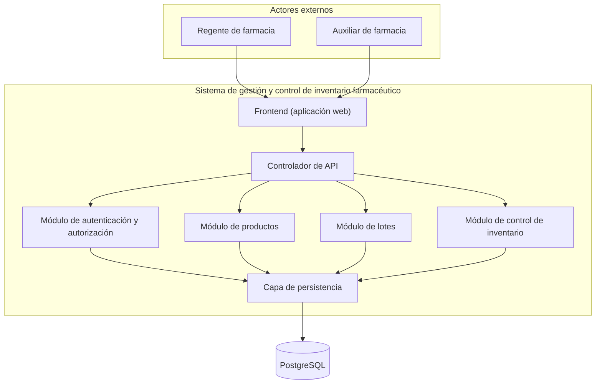
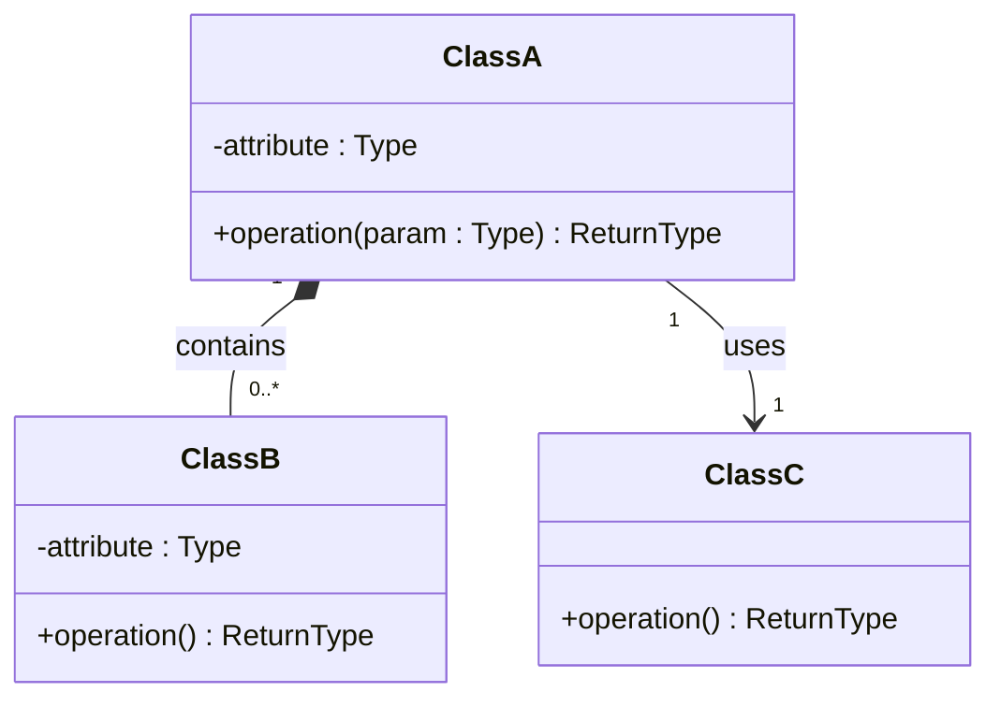

# Sistema de gestión y control de inventario farmacéutico — Diseño arquitectónico y detallado v1.0

| Campo | Información |
|---|---|
| **Equipo** | Equipo 6 |
| **Integrantes** | Junior Andrés Arrieta Tabaco, Edgar Mauricio Montufar Molano, Kevin Alexis Bermúdez Caicedo y Antonio José Moreno López |
| **Estado** | Listo para revisión |
| **Fecha** | 17/10/2026 |
| **Fuentes de entrada** | docs/req/, docs/requirements/ (REQ-RF-03.md) y los apuntes y materiales de las clases 11 y 12 proporcionados por el profesor. |

---

## 1. System Overview & Design Drivers

**System purpose** (2–3 sentences, in terms of the need it satisfies)
>

**Requirements that shape the structure** *(the ones that most influence the design, not all of them)*

| Requirement / Use Case ID | Why it shapes the structure | Quality attribute, constraint or business rule involved |
|---|---|---|
| | | |

---

## 2. Architectural Design

*(Outward-facing: what are the major parts, what is each responsible for, how do they interact?)*

### 2.1 System Context & Boundary

| Outside the system | Type (actor / external system / hardware) | How the system interacts with it |
|---|---|---|
| | | |

### 2.2 Components, Responsibilities & Capabilities

Cover the principal functional scope of your whole system.


*(Everything inside `SYS` is what you build and control. Everything outside is what you only interact with. Label each arrow with the capability being requested.)*

| Component | Main responsibility | Requirements / use cases supported | Provided capabilities | Required capabilities | Main dependencies |
|---|---|---|---|---|---|
| | | | | | |

*Checks: is every component named by responsibility, not technology ("the component that persists orders", not "the database")? Does any component exist only to make the diagram look more complex?*

---


---

## 2. Diseño arquitectónico

La arquitectura del sistema se organiza mediante una aplicación web, un controlador de API, módulos funcionales y una capa de persistencia conectada a PostgreSQL. Esta organización separa la interacción con los usuarios, el procesamiento de las solicitudes, las responsabilidades funcionales y el almacenamiento de los datos.

Para este diseño se considera únicamente el requisito funcional **RF-03: Bloqueo temporal de acceso por intentos fallidos de autenticación**. El sistema debe bloquear temporalmente el acceso después de cinco intentos consecutivos fallidos de autenticación, durante un período de cinco minutos.

### 2.1 Contexto y límites del sistema

| Elemento externo al sistema | Tipo (actor / sistema externo / hardware) | Forma de interacción con el sistema |
|---|---|---|
| Regente de farmacia | Actor | Accede a la aplicación web para autenticarse y utilizar las funcionalidades autorizadas. Si alcanza cinco intentos consecutivos fallidos de autenticación, el acceso queda bloqueado temporalmente durante cinco minutos. |
| Auxiliar de farmacia | Actor | Accede a la aplicación web para autenticarse y utilizar las funcionalidades autorizadas. Si alcanza cinco intentos consecutivos fallidos de autenticación, el acceso queda bloqueado temporalmente durante cinco minutos. |

**Límites del sistema:** el sistema comprende la aplicación web (frontend), el controlador de API, el módulo de autenticación y autorización, los módulos de productos, lotes y control de inventario, y la capa de persistencia. PostgreSQL constituye el sistema de almacenamiento de datos utilizado por la capa de persistencia.

Los usuarios interactúan con el sistema mediante la aplicación web. Las solicitudes se envían al controlador de API, que las dirige al módulo correspondiente. Para el requisito RF-03, el módulo de autenticación y autorización valida las credenciales, controla los intentos fallidos y aplica el bloqueo temporal. La capa de persistencia permite acceder a los datos necesarios para gestionar la autenticación y el estado del bloqueo.

Aunque el diagrama conserva los módulos de productos, lotes y control de inventario, este entregable no desarrolla sus requisitos funcionales. El alcance funcional documentado en este punto se limita al bloqueo temporal de acceso por intentos fallidos de autenticación.

No se incluyen integraciones con sistemas externos ni dispositivos de hardware específicos, ya que no forman parte del alcance definido.

### 2.2 Componentes, responsabilidades y capacidades

La arquitectura conserva los componentes y las relaciones representados en el diagrama del equipo. Cada componente cumple una responsabilidad específica dentro de la estructura general del sistema. Para el alcance actual, el componente central es el módulo de autenticación y autorización, responsable de implementar el requisito RF-03.

#### Diagrama de componentes

El siguiente diagrama corresponde a la arquitectura definida por el equipo. Se conservan sus componentes y su organización, sin añadir componentes independientes que no estén contemplados en el diseño original.



**Descripción del diagrama:** el frontend permite la interacción con los usuarios y se comunica con el controlador de API. Este último distribuye las solicitudes entre los módulos funcionales. El módulo de autenticación y autorización se encarga de validar las credenciales y aplicar las reglas de bloqueo temporal. La capa de persistencia centraliza el acceso a PostgreSQL.

Las conexiones representan las relaciones de comunicación y dependencia entre los componentes. El diagrama muestra la estructura general de la arquitectura; el orden detallado de las operaciones se especificará posteriormente en el diseño de los casos de uso y las interacciones.

#### Responsabilidades y capacidades de los componentes

| Componente | Responsabilidad principal | Requisitos / casos de uso que soporta | Capacidades proporcionadas | Capacidades requeridas | Dependencias principales |
|---|---|---|---|---|---|
| Frontend (aplicación web) | Proporcionar la interfaz para la interacción de los usuarios con el sistema. | RF-03; CU-03. | Presentación del formulario de autenticación y de mensajes sobre el resultado del acceso o el bloqueo temporal. | Envío de solicitudes de autenticación y recepción de respuestas. | Controlador de API. |
| Controlador de API | Recibir las solicitudes del frontend y dirigirlas al módulo correspondiente. | RF-03; CU-03. | Recepción y distribución de las solicitudes de autenticación. | Operaciones de autenticación y consulta o actualización de los datos necesarios. | Módulo de autenticación y autorización. |
| Módulo de autenticación y autorización | Validar las credenciales y controlar los intentos consecutivos fallidos de autenticación. | RF-03; CU-03. | Validación de credenciales, control del contador de intentos fallidos y aplicación de un bloqueo temporal de cinco minutos al alcanzar cinco intentos consecutivos fallidos. | Acceso a los datos necesarios para la autenticación y para conservar el estado de los intentos y del bloqueo. | Capa de persistencia. |
| Módulo de productos | Gestionar la información de los productos del sistema. | Fuera del alcance funcional de este entregable. | Capacidades relacionadas con la información de los productos. | Acceso a los datos de productos. | Capa de persistencia. |
| Módulo de lotes | Gestionar la información de los lotes del sistema. | Fuera del alcance funcional de este entregable. | Capacidades relacionadas con la información de los lotes. | Acceso a los datos de lotes. | Capa de persistencia. |
| Módulo de control de inventario | Gestionar las operaciones relacionadas con el control del inventario. | Fuera del alcance funcional de este entregable. | Capacidades relacionadas con el control del inventario. | Acceso a los datos de inventario. | Capa de persistencia. |
| Capa de persistencia | Centralizar las operaciones de acceso a los datos almacenados. | Soporte técnico a RF-03. | Acceso a los datos necesarios para la autenticación y el control de los intentos fallidos. | Operaciones de almacenamiento y consulta de datos. | PostgreSQL. |
| PostgreSQL | Almacenar los datos persistentes utilizados por el sistema. | Soporte técnico a RF-03. | Conservación y recuperación de la información almacenada. | Solicitudes de acceso procedentes de la capa de persistencia. | Capa de persistencia. |

**Consideraciones de diseño:**

- El control de los intentos fallidos y la aplicación del bloqueo temporal deben implementarse en el backend, no exclusivamente en el frontend.
- Después de una autenticación exitosa, el contador de intentos fallidos consecutivos debe reiniciarse.
- Al alcanzar cinco intentos consecutivos fallidos, el acceso debe permanecer bloqueado durante cinco minutos.
- La lógica de autenticación debe impedir nuevos intentos de acceso mientras el bloqueo esté vigente.
- La implementación debe definir cómo conservar el estado de los intentos y del bloqueo ante un reinicio del servidor. Esta decisión se documentará en el diseño detallado.
- La capa de persistencia debe encapsular el acceso a PostgreSQL para reducir el acoplamiento entre el módulo de autenticación y la tecnología de almacenamiento.
- Los módulos de productos, lotes y control de inventario se conservan porque forman parte del diagrama aprobado por el profesor, pero sus funcionalidades no se desarrollan en este entregable.


---

## 3. Detailed Design

*(Inward-facing: how is each selected component designed internally?)*

### 3.1 Components selected (at least two)

| Component | Why it was selected (risk, complexity, centrality to the drivers) |
|---|---|
| | |

### 3.2 Class Diagram(s)



*(Visibility: `-` private, `+` public. Relationships: `-->` association, `*--` composition (the part cannot exist without the whole), `<|--` generalization (a specialized type of). Add multiplicity in quotes. Use composition or generalization only when their meaning is justified. Do not force them.)*

### 3.3 Class Responsibilities

| Class | Component it belongs to | Responsibility | Key collaborators |
|---|---|---|---|
| | | | |

*(Every class must belong to an identifiable component. Do not replace the component diagram with one large class diagram.)*

### 3.4 Behavior of one key operation

*(The operation you designed in Class 12, or a more important one. At most about 15 lines. Include at least one non-happy path.)*

```text

```

---

## 4. Design Quality — Cohesion, Coupling, Information Hiding

| Question | Your answer, with evidence from your design |
|---|---|
| **Cohesion:** do the responsibilities inside each class or component belong together? | |
| **Coupling:** how far does a change in one element spread? Where are the strongest dependencies? | |
| **Information hiding:** what did you keep private or internal, and why? | |

**At least one real finding** (a problem you found in your own design) **and what you changed or would change:**
>

---

## 5. Design Decisions & Decision Record

Two decisions are required: one architectural (Class 11 level) and one detailed-design (Class 12 level). Avoid "it is best practice", "it scales" or "it is cleaner" without project evidence.

### Decision A — Architectural

| | |
|---|---|
| **Context** (requirement, constraint or problem that motivated it) | |
| **Decision** | |
| **Rationale** (why it is reasonable here) | |
| **Trade-off accepted** | |

### Decision B — Detailed design

| | |
|---|---|
| **Context** | |
| **Decision** | |
| **Rationale** | |
| **Trade-off accepted** | |

### ADR

At least one of the two decisions above must also be recorded as an ADR (use `Plantilla_ADR_Nygard`) in `docs/decisions/`.

**ADR file:** `docs/decisions/ADR-XXX-title.md` — records Decision [A / B].

---

## 6. Traceability

| Requirement ID | Use Case | Component(s) | Class(es) |
|---|---|---|---|
| | | | |

*(Every requirement in Section 1 must appear. Every component and class should appear at least once. If an element traces to nothing, ask why it exists.)*

---

## 7. Optional — AI-Assisted Design Reflection

> One design recommendation generated by AI that the team accepted, modified or rejected, and why.

---

## 8. Consistency Checklist

- [ ] Every component in the diagram appears in the responsibilities table, and the other way around.
- [ ] Every class belongs to an identifiable component.
- [ ] Components are named by responsibility, not technology.
- [ ] Nothing inside the system boundary is something you do not control.
- [ ] Provided and required capabilities match across components (what one requires, another provides).
- [ ] Both decisions name a real cost or limitation, and at least one has an ADR.
- [ ] The traceability table has no empty rows and no orphan components or classes.
- [ ] Diagrams render correctly on GitHub (or the exported images are embedded).
