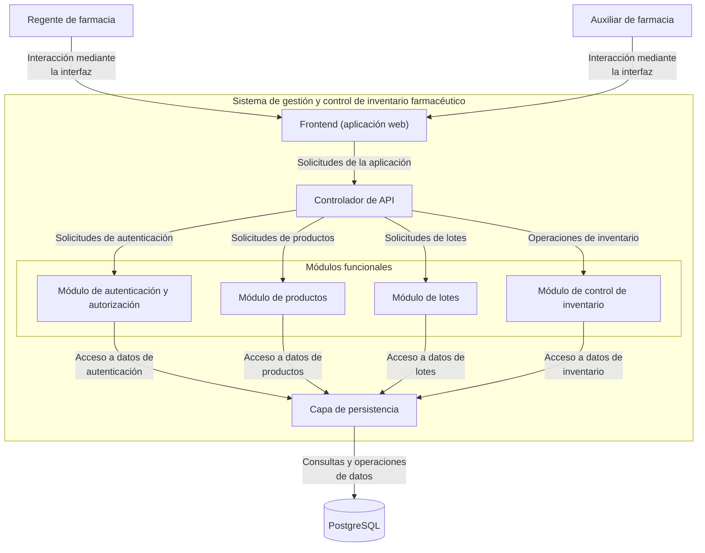
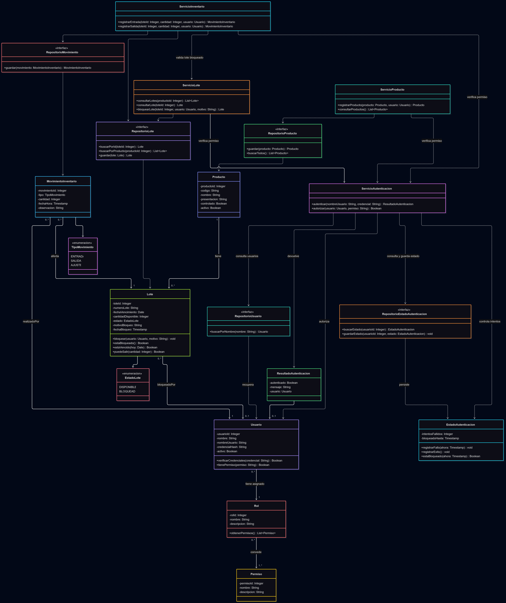

# Sistema de gestión y control de inventario farmacéutico — Diseño arquitectónico y detallado v1.0

| Campo | Información |
|---|---|
| **Equipo** | Equipo 6 |
| **Integrantes** | Junior Andrés Arrieta Tabaco, Edgar Mauricio Montufar Molano, Kevin Alexis Bermúdez Caicedo y Antonio José Moreno López |
| **Estado** | Listo para revisión |
| **Fecha** | 17/10/2026 |
| **Fuentes de entrada** | docs/req/, docs/requirements/ (REQ-RF-03.md) y los apuntes y materiales de las clases 11 y 12 proporcionados por el profesor. |

---

## 1. Visión general del sistema y factores que guían el diseño

### Propósito del sistema

El sistema de gestión y control de inventario farmacéutico busca administrar los productos, sus lotes y los movimientos de inventario, manteniendo información consistente sobre las cantidades disponibles. También permite controlar el acceso según los roles de los usuarios y bloquear lotes que no deben utilizarse para registrar salidas.

### Requisitos que influyen en la estructura

| ID del requisito / caso de uso | Por qué influye en la estructura | Atributo de calidad, restricción o regla de negocio involucrada |
|---|---|---|
| **RF-02 – Bloqueo de lotes** | Requiere separar la gestión de lotes de las operaciones de inventario, para validar que un lote bloqueado no permita registrar salidas. | Integridad del inventario. |
| **RF-03 – Bloqueo temporal por intentos fallidos** | El sistema debe controlar desde el backend los intentos fallidos de inicio de sesión y bloquear temporalmente el acceso después de cinco intentos consecutivos incorrectos, durante cinco minutos. | Seguridad. El sistema debe bloquear el acceso durante cinco minutos después de cinco intentos consecutivos fallidos (RN-01). Si el usuario inicia sesión correctamente, el contador de intentos fallidos debe reiniciarse (RN-02). |
| **Registro de entradas y salidas de inventario** | El sistema necesita un componente que valide las entradas y salidas de productos, compruebe las cantidades disponibles y registre cada movimiento utilizando los repositorios para guardar la información. | Consistencia de los datos y trazabilidad de los movimientos. |
| **Gestión de productos y lotes** | El sistema debe diferenciar la información general de cada medicamento de los datos particulares de sus lotes, como el número de lote, la fecha de vencimiento y la cantidad disponible. | Permite mantener la información ordenada y facilita modificar o ampliar el sistema sin afectar otras funcionalidades. |
| **Persistencia de la información** | El sistema debe contar con una capa de persistencia que organice el almacenamiento y la consulta de productos, lotes, movimientos y usuarios mediante repositorios. Así, los servicios no necesitan acceder directamente a PostgreSQL y resulta más fácil modificar la forma de guardar los datos sin afectar la lógica del sistema. | Facilidad para realizar cambios, responsabilidades bien definidas y conservación segura de la información del sistema. |
| **Control de acceso por roles** | El sistema debe comprobar que cada usuario tenga los permisos necesarios antes de permitirle realizar acciones restringidas, como bloquear un lote. | Protección del sistema mediante permisos que determinan qué acciones puede realizar cada usuario según su rol. |

---

## 2. Diseño arquitectónico

### 2.1 Contexto y límites del sistema

| Elemento externo al sistema | Tipo (actor / sistema externo / hardware) | Cómo interactúa el sistema con él |
|---|---|---|
| Regente de farmacia | Actor | Se autentica en la aplicación web para acceder al sistema. Puede controlar el inventario, registrar productos, añadir productos al inventario, registrar salidas de productos y marcar lotes como bloqueados. El sistema controla sus intentos fallidos de autenticación y bloquea temporalmente su acceso cuando alcanza el límite establecido. |
| Auxiliar de farmacia | Actor | Se autentica en la aplicación web. Puede registrar productos, ingresar productos al inventario y registrar salidas de productos del inventario. El sistema controla sus intentos fallidos de autenticación y bloquea temporalmente su acceso cuando alcanza el límite establecido. |

### 2.2 Componentes, responsabilidades y capacidades

El sistema contempla los requisitos funcionales RF-02 (bloqueo de lotes) y RF-03 (bloqueo temporal de acceso por intentos fallidos de autenticación). Su arquitectura cuenta con dos actores externos: el regente de farmacia y el auxiliar de farmacia. Ambos interactúan con el sistema mediante un **frontend (aplicación web)**, que se comunica con una **API** encargada de dirigir las solicitudes a los módulos. Estos módulos se conectan con una **capa de persistencia**, responsable de gestionar el acceso a la base de datos PostgreSQL.

#### Diagrama de componentes




#### Responsabilidades y capacidades

| Componente | Responsabilidad principal | Requisitos / casos de uso que soporta | Capacidades proporcionadas | Capacidades requeridas | Dependencias principales |
|---|---|---|---|---|---|
| Frontend (aplicación web) | Proporcionar la interfaz de interacción entre los usuarios y el sistema. | RF-02, RF-03; CU-02, CU-03. | Presentar el inicio de sesión y permitir a ambos roles registrar productos, entradas y salidas del inventario, reflejando los cambios y mostrando confirmaciones. El regente también puede bloquear lotes. El sistema informa sobre bloqueos temporales por intentos fallidos de autenticación. | Servicios de autenticación y operaciones de inventario mediante la API. | Controlador de API. |
| Controlador de API | Recibir las solicitudes del frontend y dirigirlas al módulo correspondiente. | RF-02, RF-03; CU-02, CU-03. | Gestionar las solicitudes de autenticación, bloqueo de lotes, productos e inventario. | Operaciones ofrecidas por los módulos. | Módulo de autenticación y autorización, módulo de productos, módulo de lotes y módulo de control de inventario. |
| Módulo de autenticación y autorización | Validar las credenciales, controlar los intentos fallidos y aplicar las restricciones de acceso. | RF-03; CU-03. | Validar credenciales, controlar los intentos consecutivos fallidos y bloquear temporalmente el acceso durante cinco minutos después de cinco intentos fallidos consecutivos. | Consultar la base de datos para validar las credenciales y consultar o actualizar la cantidad de intentos fallidos y la fecha y hora hasta la que se bloquea el acceso. | Capa de persistencia. |
| Módulo de productos | Gestionar el registro y la consulta de los productos del sistema. | RF-02; CU-02. | Registrar nuevos productos y consultar la información de los productos existentes. | Guardar y consultar los datos de los productos mediante la capa de persistencia y solicitar al módulo de lotes la asociación de los lotes correspondientes. | Capa de persistencia y módulo de lotes. |
| Módulo de lotes | Gestionar la información y el estado de los lotes de productos farmacéuticos. | RF-02; CU-02. | Consultar los lotes y registrar el estado de bloqueo de un lote. | Acceso a los datos de los lotes y actualización de su estado. | Capa de persistencia. |
| Módulo de control de inventario | Gestionar las entradas y salidas de productos del inventario. | RF-02; CU-02. | Registrar entradas y salidas de productos, actualizar las existencias disponibles y verificar que los lotes bloqueados no se registren como disponibles para salida. | Consulta del estado de los lotes y acceso a los datos de inventario. | Módulo de lotes y capa de persistencia. |
| Capa de persistencia | Facilitar a los módulos del sistema el acceso a la base de datos para consultar, guardar y actualizar información. | Soporte a RF-02 y RF-03. | Consultar y almacenar información de productos, lotes, inventario y los datos necesarios para gestionar la autenticación y los bloqueos temporales. | Una base de datos que permita guardar, consultar y actualizar la información del sistema. | PostgreSQL. |
| PostgreSQL | Almacenar de forma persistente la información del sistema. | Soporte a RF-02 y RF-03. | Conservar y recuperar los datos solicitados por la capa de persistencia. | Consultas y operaciones de lectura y escritura. | Capa de persistencia. |

*Verificaciones del diseño:*

- Cada componente tiene una responsabilidad identificable y relacionada con el funcionamiento del sistema.
- El módulo de autenticación y autorización controla los intentos fallidos desde el backend, sin depender exclusivamente del navegador.
- El contador de intentos fallidos consecutivos debe reiniciarse después de una autenticación exitosa.
- El módulo de lotes administra el estado de bloqueo, mientras que el módulo de control de inventario verifica dicho estado e impide registrar como disponibles para salida las unidades pertenecientes a lotes bloqueados.
- La capa de persistencia separa el acceso a los datos de la lógica de los módulos funcionales.
- Los módulos se comunican a través del controlador de API y la capa de persistencia según las responsabilidades definidas en la arquitectura.
- La estrategia concreta para conservar el estado de los intentos fallidos y la duración del bloqueo ante un reinicio del servidor deberá definirse en el diseño detallado.

---

## 3. Diseño detallado

### 3.1 Componentes seleccionados

| Componente | Justificación de la selección (riesgo, complejidad, importancia para los objetivos de diseño) |
|---|---|
| **Módulo de autenticación y autorización** | Se selecciona porque verifica la identidad de los usuarios y controla sus permisos según su rol. Debe gestionar el bloqueo temporal de cinco minutos después de cinco intentos consecutivos fallidos. Un error podría permitir accesos no autorizados o bloquear usuarios legítimos. |
| **Módulo de lotes** | Se selecciona porque administra los lotes y sus estados. Es fundamental para garantizar que los lotes bloqueados no puedan utilizarse para registrar salidas de inventario. Un error podría permitir movimientos no autorizados. |
| **Módulo de control de inventario** | Se selecciona porque gestiona las entradas, las salidas y los movimientos de inventario. Debe validar la cantidad disponible y comprobar que el lote no esté bloqueado antes de registrar una salida, evitando inconsistencias en las cantidades. |
| **Módulo de productos** | Se selecciona porque permite registrar y consultar los productos farmacéuticos. Debe mantener organizados sus datos generales y diferenciarlos de la información específica de cada lote. Una separación incorrecta podría generar confusiones o inconsistencias en la información de los productos. |
| **Capa de persistencia** | Se selecciona porque los repositorios permiten guardar y buscar la información en PostgreSQL de forma organizada, sin que cada parte del sistema tenga que hacerlo directamente. |


### 3.2 Diagrama de clases



### 3.3 Responsabilidades de las clases

| Clase | Componente al que pertenece | Responsabilidad | Colaboradores principales |
|---|---|---|---|
| `ServicioAutenticacion` | Módulo de autenticación y autorización | Autenticar usuarios, verificar permisos y gestionar el proceso de acceso. | `RepositorioUsuario`, `RepositorioEstadoAutenticacion`, `Usuario`, `EstadoAutenticacion`, `ResultadoAutenticacion` |
| `Usuario` | Módulo de autenticación y autorización | Representar al usuario, verificar sus credenciales y consultar sus permisos. | `Rol`, `ServicioAutenticacion` |
| `Rol` | Módulo de autenticación y autorización | Agrupar los permisos asignados a un rol. | `Permiso`, `Usuario` |
| `Permiso` | Módulo de autenticación y autorización | Representar una autorización específica dentro del sistema. | `Rol` |
| `EstadoAutenticacion` | Módulo de autenticación y autorización | Registrar los intentos fallidos y determinar si el acceso está temporalmente bloqueado. | `ServicioAutenticacion`, `RepositorioEstadoAutenticacion` |
| `ResultadoAutenticacion` | Módulo de autenticación y autorización | Representar el resultado de un intento de autenticación. | `ServicioAutenticacion`, `Usuario` |
| `ServicioProducto` | Módulo de productos | Registrar y consultar productos farmacéuticos. | `RepositorioProducto`, `ServicioAutenticacion`, `Producto` |
| `Producto` | Módulo de productos | Representar los datos principales de un producto farmacéutico. | `Lote`, `ServicioProducto` |
| `ServicioLote` | Módulo de lotes | Consultar lotes y gestionar el bloqueo de un lote, verificando los permisos correspondientes. | `RepositorioLote`, `ServicioAutenticacion`, `Lote` |
| `Lote` | Módulo de lotes | Representar un lote, su cantidad disponible, estado y condiciones para permitir una salida. | `Producto`, `Usuario`, `EstadoLote`, `ServicioLote`, `ServicioInventario` |
| `EstadoLote` | Módulo de lotes | Definir los estados posibles de un lote: disponible o bloqueado. | `Lote` |
| `ServicioInventario` | Módulo de control de inventario | Registrar entradas y salidas, validar las condiciones del lote y generar los movimientos correspondientes. | `RepositorioLote`, `ServicioLote`, `RepositorioMovimiento`, `ServicioAutenticacion`, `MovimientoInventario` |
| `MovimientoInventario` | Módulo de control de inventario | Representar cada movimiento registrado, incluyendo tipo, cantidad, fecha y observación. | `Lote`, `Usuario`, `TipoMovimiento` |
| `TipoMovimiento` | Módulo de control de inventario | Definir los tipos de movimiento contemplados en el diseño. | `MovimientoInventario` |
| `RepositorioProducto` | Capa de persistencia | Definir las operaciones para guardar y consultar productos. | `Producto`, `ServicioProducto` |
| `RepositorioLote` | Capa de persistencia | Definir las operaciones para buscar y guardar lotes. | `Lote`, `ServicioLote`, `ServicioInventario` |
| `RepositorioMovimiento` | Capa de persistencia | Definir la operación para guardar movimientos de inventario. | `MovimientoInventario`, `ServicioInventario` |
| `RepositorioUsuario` | Capa de persistencia | Definir la operación para buscar usuarios por nombre de usuario. | `Usuario`, `ServicioAutenticacion` |
| `RepositorioEstadoAutenticacion` | Capa de persistencia | Definir las operaciones para consultar y guardar el estado de autenticación de un usuario. | `EstadoAutenticacion`, `ServicioAutenticacion` |


### 3.4 Comportamiento de una operación clave

**Operación seleccionada:** `registrarSalida(loteId, cantidad, usuario)`

**Descripción:** Registra una salida de inventario cuando el usuario tiene permiso, el lote no está bloqueado y existe una cantidad suficiente.

**Pseudocódigo:**

```text
función registrarSalida(loteId, cantidad, usuario):
    si no autorizar(usuario, "REGISTRAR_SALIDA"):
        retornar error("Usuario sin permisos")
    si cantidad <= 0:
        retornar error("Cantidad inválida")
    lote = consultarLote(loteId)
    si lote no existe:
        retornar error("Lote no encontrado")
    si lote.estaBloqueado():
        retornar error("El lote está bloqueado")
    si lote.cantidadDisponible < cantidad:
        retornar error("Cantidad insuficiente")
    iniciar transacción
    descontar cantidad del lote
    guardar cambios del lote
    movimiento = crear movimiento SALIDA
    guardar movimiento en el repositorio
    confirmar transacción
    retornar movimiento
```

**Resultado esperado:** Si las validaciones se cumplen, se registra el movimiento de salida y se actualiza la cantidad disponible. Si alguna validación falla, se devuelve un error y no se registra la salida.

---

## 4. Calidad del diseño — Cohesión, acoplamiento y ocultamiento de información

| Pregunta | Respuesta, con evidencia del diseño |
|---|---|
| **Cohesión:** ¿Las responsabilidades dentro de cada clase o componente están relacionadas entre sí? | Sí. Las responsabilidades están separadas por propósito: `ServicioAutenticacion` gestiona la autenticación y los permisos, `ServicioLote` administra los lotes y sus bloqueos, y `ServicioInventario` registra las entradas y salidas. Esta separación facilita comprender y mantener cada componente. |
| **Acoplamiento:** ¿Hasta qué punto se propagan los cambios de un elemento? ¿Dónde están las dependencias más fuertes? | Los servicios dependen de interfaces de repositorio para acceder a los datos, lo que reduce su dependencia de la implementación de la base de datos. Sin embargo, `ServicioInventario` depende de varios elementos, como `ServicioLote`, los repositorios y `ServicioAutenticacion`, por lo que sus cambios pueden afectar varias colaboraciones. |
| **Ocultamiento de información:** ¿Qué elementos se mantuvieron privados o internos y por qué? | Los atributos de las entidades, como `cantidadDisponible` en `Lote` y `credencialHash` en `Usuario`, se definen como privados. Así se evita su modificación directa desde otras clases y se centraliza el acceso mediante operaciones que protegen las reglas del sistema. |

**Hallazgo real del diseño y qué se cambió o se cambiaría:**

Se identificó que, al registrar una salida, se debe revisar el lote y la cantidad disponible, y guardar el movimiento. Se propone que estos pasos se realicen juntos en una misma transacción, para evitar errores en el inventario. Si algo falla, los cambios se cancelan.

---

## 5. Decisiones de diseño y registro de decisiones

Se establecen dos decisiones técnicas para el diseño del sistema: una relacionada con la autenticación y otra con el control del inventario.

### Decisión A — Arquitectura (Gestión de bloqueos de seguridad)

| Elemento | Descripción |
|---|---|
| **Contexto** | El sistema debe bloquear el inicio de sesión durante 5 minutos después de 5 intentos fallidos consecutivos. Si estos intentos se guardan solo en la memoria del servidor, se pueden perder cuando este se reinicie. |
| **Decisión** | Guardar los intentos fallidos y el tiempo de bloqueo en PostgreSQL, utilizando `AuthStateRepository` y `EstadoAutenticacion`, que ya están incluidos en el modelo de clases. |
| **Justificación** | Así, el sistema puede recordar los intentos fallidos y mantener el bloqueo aunque el servidor se reinicie. |
| **Concesión aceptada** | Será necesario consultar y actualizar la base de datos durante el inicio de sesión. Esto añade trabajo al sistema, pero permite conservar la información del bloqueo. |

### Decisión B — Diseño detallado (Control de las salidas de inventario)

| Elemento | Descripción |
|---|---|
| **Contexto** | Al registrar una salida, el sistema debe descontar las unidades disponibles del lote y guardar el movimiento correspondiente. Si una de estas acciones falla, la información del inventario podría quedar incorrecta. |
| **Decisión** | Realizar el descuento de las unidades del lote y el registro del movimiento dentro de una misma transacción de base de datos. |
| **Justificación** | Si ocurre un error, la transacción permite deshacer los cambios para evitar que la cantidad del lote y los movimientos registrados queden inconsistentes. |
| **Concesión aceptada** | Se debe controlar qué ocurre si hay errores o si dos usuarios intentan registrar salidas al mismo tiempo. Esto añade complejidad, pero ayuda a mantener las cantidades del inventario correctas. |

### ADR

**ADR file:** [`ADR-0003-persistencia-bloqueos-seguridad.md`](../decisions/ADR-0003-persistencia-bloqueos-seguridad.md) — registra la decisión de guardar los intentos fallidos y el tiempo de bloqueo en PostgreSQL.
---

## 6. Trazabilidad

La siguiente tabla muestra cómo se relacionan los requisitos del sistema con los casos de uso, los componentes de la arquitectura y las clases del modelo UML. Esto permite identificar qué partes del diseño ayudan a cumplir cada requisito.

| ID de requisito | Caso de uso | Componentes | Clases relacionadas |
|---|---|---|---|
| **RF-02 – Bloqueo de lotes** | **CU-02 – Gestión de lotes e inventario** | Controlador de API, módulo de lotes, módulo de control de inventario y capa de persistencia. | `ServicioLote`, `Lote`, `EstadoLote`, `ServicioInventario`, `RepositorioLote`, `RepositorioMovimiento`, `MovimientoInventario` |
| **RF-03 – Bloqueo temporal por intentos fallidos** | **CU-03 – Autenticación de usuarios** | Frontend, controlador de API, módulo de autenticación y autorización, capa de persistencia y PostgreSQL. | `ServicioAutenticacion`, `Usuario`, `Rol`, `Permiso`, `EstadoAutenticacion`, `ResultadoAutenticacion`, `RepositorioUsuario`, `RepositorioEstadoAutenticacion` |
| **Registro y consulta de productos** | **CU-02 – Gestión de productos e inventario** | Controlador de API, módulo de productos y capa de persistencia. | `ServicioProducto`, `Producto`, `RepositorioProducto` |
| **Registro de entradas y salidas de inventario** | **CU-02 – Gestión de productos e inventario** | Controlador de API, módulo de control de inventario, módulo de lotes y capa de persistencia. | `ServicioInventario`, `Lote`, `MovimientoInventario`, `TipoMovimiento`, `RepositorioLote`, `RepositorioMovimiento`, `ServicioLote` |
| **Control de acceso por roles y permisos** | **CU-03 – Autenticación de usuarios** | Controlador de API y módulo de autenticación y autorización. | `ServicioAutenticacion`, `Usuario`, `Rol`, `Permiso`, `ServicioProducto`, `ServicioLote`, `ServicioInventario` |
| **Persistencia de productos, lotes, movimientos y autenticación** | **CU-02 y CU-03** | Capa de persistencia y PostgreSQL. | `RepositorioProducto`, `RepositorioLote`, `RepositorioMovimiento`, `RepositorioUsuario`, `RepositorioEstadoAutenticacion` |


---


 ## 7. Reflexión sobre el diseño asistido por IA

La IA recomendó revisar los riesgos asociados al requerimiento RF-03, especialmente la posibilidad de bloquear intencionalmente a usuarios legítimos, mantener el bloqueo más de cinco minutos o perder el contador de intentos tras un reinicio del servidor. El equipo evaluó estas recomendaciones y adaptó las mitigaciones al alcance del proyecto: considerar el uso de CAPTCHA, validar la duración del bloqueo desde el backend y almacenar el estado de autenticación en PostgreSQL. Se mantuvo el CAPTCHA como una medida por evaluar, mientras que la persistencia del contador y del bloqueo se incorporó a las decisiones de diseño.

---

## 8. Lista de verificacion de consistencia

- [x] Todos los componentes del diagrama aparecen en la tabla de responsabilidades y viceversa.
- [x] Cada clase pertenece a un componente identificable.
- [ ] Los componentes se nombran según sus responsabilidades, no según la tecnología que utilizan.
- [x] Ningún elemento ubicado dentro de los límites del sistema está fuera de tu control.
- [x] Las capacidades proporcionadas y requeridas coinciden entre los componentes.
- [ ] Ambas decisiones especifican un costo o una limitación real, y al menos una cuenta con un ADR (Registro de Decisión Arquitectónica).
- [x] La tabla de trazabilidad no contiene filas vacías ni componentes o clases sin relación con los requisitos.
- [x] Los diagramas se visualizan correctamente en GitHub o se incluyen imágenes exportadas de estos.
