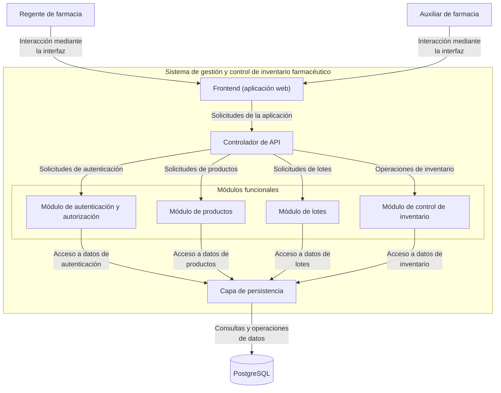
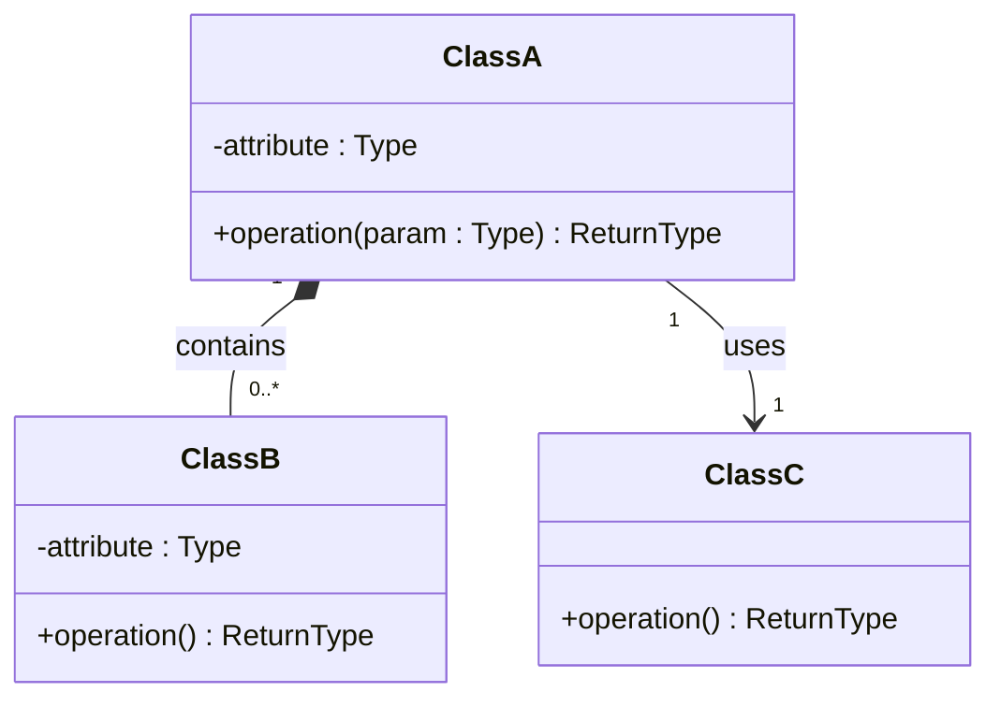

# Sistema de gestión y control de inventario farmacéutico — Diseño arquitectónico y detallado v1.0

| Campo | Información |
|---|---|
| **Equipo** | Equipo 6 |
| **Integrantes** | Junior Andrés Arrieta Tabaco, Edgar Mauricio Montufar Molano, Kevin Alexis Bermúdez Caicedo y Antonio José Moreno López |
| **Estado** | Listo para revisión |
| **Fecha** | 17/10/2026 |
| **Fuentes de entrada** | docs/req/, docs/requirements/ (REQ-RF-03.md) y los apuntes y materiales de las clases 11 y 12 proporcionados por el profesor. |

---

## 1. System Overview & Design Drivers

**System purpose** (2–3 sentences, in terms of the need it satisfies)
>

**Requirements that shape the structure** *(the ones that most influence the design, not all of them)*

| Requirement / Use Case ID | Why it shapes the structure | Quality attribute, constraint or business rule involved |
|---|---|---|
| | | |

---

## 2. Architectural Design

*(Outward-facing: what are the major parts, what is each responsible for, how do they interact?)*

### 2.1 System Context & Boundary

| Outside the system | Type (actor / external system / hardware) | How the system interacts with it |
|---|---|---|
| | | |

### 2.2 Components, Responsibilities & Capabilities

Cover the principal functional scope of your whole system.


*(Everything inside `SYS` is what you build and control. Everything outside is what you only interact with. Label each arrow with the capability being requested.)*

| Component | Main responsibility | Requirements / use cases supported | Provided capabilities | Required capabilities | Main dependencies |
|---|---|---|---|---|---|
| | | | | | |

*Checks: is every component named by responsibility, not technology ("the component that persists orders", not "the database")? Does any component exist only to make the diagram look more complex?*

---


---

## 2. Diseño arquitectónico

*(Visión externa: ¿cuáles son las partes principales, de qué es responsable cada una y cómo interactúan?)*

### 2.1 Contexto y límites del sistema

| Elemento externo al sistema | Tipo (actor / sistema externo / hardware) | Cómo interactúa el sistema con él |
|---|---|---|
| Regente de farmacia | Actor | Se autentica en la aplicación web para acceder al sistema. Puede controlar el inventario, registrar productos, añadir productos al inventario, registrar salidas de productos y marcar lotes como bloqueados. El sistema controla sus intentos fallidos de autenticación y bloquea temporalmente su acceso cuando alcanza el límite establecido. |
| Auxiliar de farmacia | Actor | Se autentica en la aplicación web. Puede registrar productos, ingresar productos al inventario y registrar salidas de productos del inventario. El sistema controla sus intentos fallidos de autenticación y bloquea temporalmente su acceso cuando alcanza el límite establecido. |

### 2.2 Componentes, responsabilidades y capacidades

El sistema contempla los requisitos funcionales RF-02 (bloqueo de lotes) y RF-03 (bloqueo temporal de acceso por intentos fallidos de autenticación). Su arquitectura cuenta con dos actores externos: el regente de farmacia y el auxiliar de farmacia. Ambos interactúan con el sistema mediante un **frontend (aplicación web)**, que se comunica con una **API** encargada de dirigir las solicitudes a los módulos. Estos módulos se conectan con una **capa de persistencia**, responsable de gestionar el acceso a la base de datos PostgreSQL.

#### Diagrama de componentes




#### Responsabilidades y capacidades

| Componente | Responsabilidad principal | Requisitos / casos de uso que soporta | Capacidades proporcionadas | Capacidades requeridas | Dependencias principales |
|---|---|---|---|---|---|
| Frontend (aplicación web) | Proporcionar la interfaz de interacción entre los usuarios y el sistema. | RF-02, RF-03; CU-02, CU-03. | Presentar el inicio de sesión y permitir a ambos roles registrar productos, entradas y salidas del inventario, reflejando los cambios y mostrando confirmaciones. El regente también puede bloquear lotes. El sistema informa sobre bloqueos temporales por intentos fallidos de autenticación. | Servicios de autenticación y operaciones de inventario mediante la API. | Controlador de API. |
| Controlador de API | Recibir las solicitudes del frontend y dirigirlas al módulo correspondiente. | RF-02, RF-03; CU-02, CU-03. | Gestionar las solicitudes de autenticación, bloqueo de lotes, productos e inventario. | Operaciones ofrecidas por los módulos. | Módulo de autenticación y autorización, módulo de productos, módulo de lotes y módulo de control de inventario. |
| Módulo de autenticación y autorización | Validar las credenciales, controlar los intentos fallidos y aplicar las restricciones de acceso. | RF-03; CU-03. | Validar credenciales, controlar los intentos consecutivos fallidos y bloquear temporalmente el acceso durante cinco minutos después de cinco intentos fallidos consecutivos. | Consultar la base de datos para validar las credenciales y consultar o actualizar el contador de intentos fallidos y el estado del bloqueo temporal. | Capa de persistencia. |
| Módulo de productos | Gestionar el registro y la consulta de los productos del sistema. | RF-02; CU-02. | Registrar nuevos productos, asociarlos con sus lotes y consultar la información de los productos existentes. | Consultar y almacenar los datos de productos y sus lotes mediante la capa de persistencia. | Capa de persistencia. |
| Módulo de lotes | Gestionar la información y el estado de los lotes de productos farmacéuticos. | RF-02; CU-02. | Consultar los lotes y registrar el estado de bloqueo de un lote solicitado por un regente autorizado. | Acceso a los datos de los lotes y actualización de su estado. | Capa de persistencia. |
| Módulo de control de inventario | Aplicar las reglas relacionadas con las operaciones y las cantidades disponibles del inventario. | RF-02; CU-02. | Verificar el estado de bloqueo de los lotes e impedir que las unidades de un lote bloqueado se registren como disponibles para salida. | Consulta del estado de los lotes y acceso a los datos de inventario. | Módulo de lotes y capa de persistencia. |
| Capa de persistencia | Centralizar el acceso y la actualización de los datos almacenados por el sistema. | Soporte a RF-02 y RF-03. | Consultar y almacenar información de productos, lotes, inventario y los datos necesarios para gestionar la autenticación y los bloqueos temporales. | Servicio de almacenamiento y recuperación de datos. | PostgreSQL. |
| PostgreSQL | Almacenar de forma persistente la información del sistema. | Soporte a RF-02 y RF-03. | Conservar y recuperar los datos solicitados por la capa de persistencia. | Consultas y operaciones de lectura y escritura. | Capa de persistencia. |

*Verificaciones del diseño:*

- Cada componente tiene una responsabilidad identificable y relacionada con el funcionamiento del sistema.
- El módulo de autenticación y autorización controla los intentos fallidos desde el backend, sin depender exclusivamente del navegador.
- El contador de intentos fallidos consecutivos debe reiniciarse después de una autenticación exitosa.
- El módulo de lotes administra el estado de bloqueo y el módulo de control de inventario aplica la restricción sobre las salidas de los lotes bloqueados.
- La capa de persistencia separa el acceso a los datos de la lógica de los módulos funcionales.
- Los módulos se comunican a través del controlador de API y la capa de persistencia según las responsabilidades definidas en la arquitectura.
- La estrategia concreta para conservar el estado de los intentos fallidos y la duración del bloqueo ante un reinicio del servidor deberá definirse en el diseño detallado.

---

## 3. Detailed Design

*(Inward-facing: how is each selected component designed internally?)*

### 3.1 Components selected (at least two)

| Component | Why it was selected (risk, complexity, centrality to the drivers) |
|---|---|
| | |

### 3.2 Class Diagram(s)



*(Visibility: `-` private, `+` public. Relationships: `-->` association, `*--` composition (the part cannot exist without the whole), `<|--` generalization (a specialized type of). Add multiplicity in quotes. Use composition or generalization only when their meaning is justified. Do not force them.)*

### 3.3 Class Responsibilities

| Class | Component it belongs to | Responsibility | Key collaborators |
|---|---|---|---|
| | | | |

*(Every class must belong to an identifiable component. Do not replace the component diagram with one large class diagram.)*

### 3.4 Behavior of one key operation

*(The operation you designed in Class 12, or a more important one. At most about 15 lines. Include at least one non-happy path.)*

```text

```

---

## 4. Design Quality — Cohesion, Coupling, Information Hiding

| Question | Your answer, with evidence from your design |
|---|---|
| **Cohesion:** do the responsibilities inside each class or component belong together? | |
| **Coupling:** how far does a change in one element spread? Where are the strongest dependencies? | |
| **Information hiding:** what did you keep private or internal, and why? | |

**At least one real finding** (a problem you found in your own design) **and what you changed or would change:**
>

---

## 5. Design Decisions & Decision Record

Two decisions are required: one architectural (Class 11 level) and one detailed-design (Class 12 level). Avoid "it is best practice", "it scales" or "it is cleaner" without project evidence.

### Decision A — Architectural

| | |
|---|---|
| **Context** (requirement, constraint or problem that motivated it) | |
| **Decision** | |
| **Rationale** (why it is reasonable here) | |
| **Trade-off accepted** | |

### Decision B — Detailed design

| | |
|---|---|
| **Context** | |
| **Decision** | |
| **Rationale** | |
| **Trade-off accepted** | |

### ADR

At least one of the two decisions above must also be recorded as an ADR (use `Plantilla_ADR_Nygard`) in `docs/decisions/`.

**ADR file:** `docs/decisions/ADR-XXX-title.md` — records Decision [A / B].

---

## 6. Traceability

| Requirement ID | Use Case | Component(s) | Class(es) |
|---|---|---|---|
| | | | |

*(Every requirement in Section 1 must appear. Every component and class should appear at least once. If an element traces to nothing, ask why it exists.)*

---

## 7. Optional — AI-Assisted Design Reflection

> One design recommendation generated by AI that the team accepted, modified or rejected, and why.

---

## 8. Consistency Checklist

- [ ] Every component in the diagram appears in the responsibilities table, and the other way around.
- [ ] Every class belongs to an identifiable component.
- [ ] Components are named by responsibility, not technology.
- [ ] Nothing inside the system boundary is something you do not control.
- [ ] Provided and required capabilities match across components (what one requires, another provides).
- [ ] Both decisions name a real cost or limitation, and at least one has an ADR.
- [ ] The traceability table has no empty rows and no orphan components or classes.
- [ ] Diagrams render correctly on GitHub (or the exported images are embedded).
