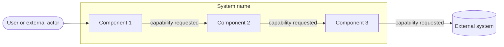
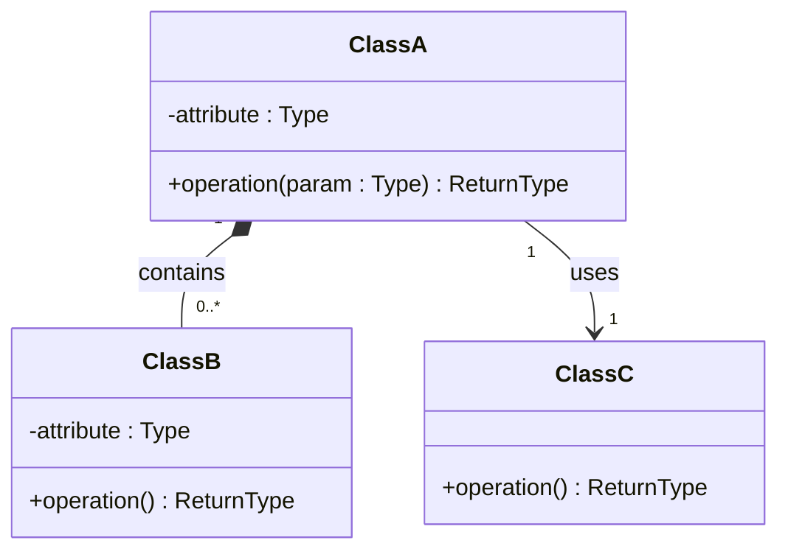

# Sistema de gestión y control de inventario farmacéutico — Diseño arquitectónico y detallado v1.0

| Campo | Información |
|---|---|
| **Equipo** | Equipo 6 |
| **Integrantes** | Junior Andrés Arrieta Tabaco, Edgar Mauricio Montufar Molano, Kevin Alexis Bermúdez Caicedo y Antonio José Moreno López |
| **Estado** | Listo para revisión |
| **Fecha** | 17/10/2026 |
| **Fuentes de entrada** | docs/req/, docs/requirements/ (REQ-RF-03.md) y los apuntes y materiales de las clases 11 y 12 proporcionados por el profesor. |

---

## 1. System Overview & Design Drivers

**System purpose** (2–3 sentences, in terms of the need it satisfies)
>

**Requirements that shape the structure** *(the ones that most influence the design, not all of them)*

| Requirement / Use Case ID | Why it shapes the structure | Quality attribute, constraint or business rule involved |
|---|---|---|
| | | |

---

## 2. Architectural Design

*(Outward-facing: what are the major parts, what is each responsible for, how do they interact?)*

### 2.1 System Context & Boundary

| Outside the system | Type (actor / external system / hardware) | How the system interacts with it |
|---|---|---|
| | | |

### 2.2 Components, Responsibilities & Capabilities

Cover the principal functional scope of your whole system.



*(Everything inside `SYS` is what you build and control. Everything outside is what you only interact with. Label each arrow with the capability being requested.)*

| Component | Main responsibility | Requirements / use cases supported | Provided capabilities | Required capabilities | Main dependencies |
|---|---|---|---|---|---|
| | | | | | |

*Checks: is every component named by responsibility, not technology ("the component that persists orders", not "the database")? Does any component exist only to make the diagram look more complex?*

---


---

## 2. Diseño arquitectónico

La arquitectura del sistema se organiza en una aplicación web, un controlador de API, módulos funcionales y una capa de persistencia conectada a PostgreSQL. Esta estructura separa la interacción con los usuarios, el procesamiento de las solicitudes y el almacenamiento de los datos.

Para este diseño se consideran únicamente los siguientes requisitos funcionales:

- **RF-01:** Exportar el inventario en formato PDF.
- **RF-03:** Bloqueo temporal de acceso por intentos fallidos de autenticación.

### 2.1 Contexto y límites del sistema

| Elemento externo al sistema | Tipo (actor / sistema externo / hardware) | Forma de interacción con el sistema |
|---|---|---|
| Regente de farmacia | Actor | Utiliza la aplicación web para autenticarse, consultar el inventario y solicitar su exportación en formato PDF. |
| Auxiliar de farmacia | Actor | Utiliza la aplicación web para autenticarse, consultar el inventario y solicitar su exportación en formato PDF. |

**Límites del sistema:** el sistema comprende la aplicación web, el controlador de API, los módulos de autenticación y autorización, productos, lotes y control de inventario, además de la capa de persistencia. PostgreSQL se utiliza para almacenar la información necesaria para el funcionamiento del sistema.

Los actores interactúan con el sistema mediante la aplicación web. Las solicitudes se procesan a través del controlador de API y se dirigen a los módulos correspondientes, que acceden a la información persistida cuando es necesario.

El alcance de este diseño se limita a la exportación del inventario en PDF y al bloqueo temporal del acceso después de cinco intentos consecutivos fallidos de autenticación, durante cinco minutos.

No se incluyen en este entregable el bloqueo de lotes ni los módulos funcionales relacionados con ventas, compras, proveedores, facturación o contabilidad.

### 2.2 Componentes, responsabilidades y capacidades

La arquitectura conserva la organización definida en el diagrama de componentes aprobado por el profesor. Cada componente cumple una responsabilidad dentro del procesamiento de las solicitudes y se comunica con los demás mediante las interfaces correspondientes.

#### Diagrama de componentes

El diagrama arquitectónico de referencia es el elaborado por el equipo, que contiene los siguientes componentes:

- **Aplicación web (frontend):** proporciona la interfaz mediante la cual los usuarios interactúan con el sistema.
- **Controlador de API:** recibe las solicitudes del frontend y las dirige a los módulos correspondientes.
- **Módulo de autenticación y autorización:** valida las credenciales y controla el acceso, incluidos los intentos fallidos y el bloqueo temporal.
- **Módulo de productos:** gestiona las operaciones relacionadas con la consulta de productos.
- **Módulo de lotes:** permite acceder a la información de los lotes del inventario.
- **Módulo de control de inventario:** coordina las operaciones necesarias para consultar la información del inventario.
- **Capa de persistencia:** centraliza el acceso a los datos almacenados.
- **PostgreSQL:** almacena la información persistente del sistema.

Para mantener la coherencia con el diagrama original, se conservan los componentes y sus relaciones. Los requisitos incluidos en este entregable determinan qué capacidades de esos componentes se desarrollarán y documentarán.

#### Responsabilidades y capacidades de los componentes

| Componente | Responsabilidad principal | Requisitos / casos de uso que soporta | Capacidades proporcionadas | Capacidades requeridas | Dependencias principales |
|---|---|---|---|---|---|
| Aplicación web (frontend) | Proporcionar la interfaz de interacción con los usuarios. | RF-01 y RF-03. | Presentación de formularios, consulta de información del inventario, solicitud de exportación y visualización de resultados o mensajes de acceso bloqueado. | Recepción y procesamiento de solicitudes a través de la API. | Controlador de API. |
| Controlador de API | Recibir, validar y dirigir las solicitudes del frontend hacia los módulos correspondientes. | RF-01 y RF-03. | Exposición de las operaciones de la aplicación mediante una interfaz de comunicación. | Operaciones de autenticación y consulta del inventario. | Módulo de autenticación y autorización, módulo de control de inventario y demás módulos requeridos por cada operación. |
| Módulo de autenticación y autorización | Validar las credenciales y controlar los intentos fallidos de acceso. | RF-03; CU-03. | Autenticación, seguimiento de intentos consecutivos fallidos y aplicación del bloqueo temporal de cinco minutos después de cinco intentos fallidos. | Acceso a los datos necesarios para verificar las credenciales y conservar el estado del bloqueo. | Capa de persistencia. |
| Módulo de productos | Gestionar la información de los productos que forman parte del inventario. | RF-01; CU-01. | Consulta de la información de los productos incluida en el inventario. | Acceso a los datos persistidos de los productos. | Capa de persistencia. |
| Módulo de lotes | Gestionar la información de los lotes asociados a los productos. | RF-01; CU-01. | Consulta de lotes, cantidades disponibles y fechas de vencimiento. | Acceso a los datos persistidos de los lotes. | Capa de persistencia. |
| Módulo de control de inventario | Coordinar la consulta de los datos necesarios para obtener el inventario que se exportará. | RF-01; CU-01. | Obtención de la información de productos y lotes requerida para preparar el reporte. | Consultas de productos y lotes. | Módulos de productos y lotes; capa de persistencia, según la implementación. |
| Capa de persistencia | Centralizar las operaciones de lectura y escritura de los datos del sistema. | Soporte a RF-01 y RF-03. | Acceso controlado a la información persistente. | Servicio de almacenamiento de datos. | PostgreSQL. |
| PostgreSQL | Almacenar la información persistente utilizada por el sistema. | Soporte a RF-01 y RF-03. | Conservación y recuperación de los datos almacenados. | Solicitudes de acceso realizadas a través de la capa de persistencia. | Capa de persistencia. |

**Consideraciones de diseño:**

- El bloqueo temporal por intentos fallidos debe controlarse en el backend, no exclusivamente en la aplicación web.
- El contador de intentos debe reiniciarse después de una autenticación exitosa, de acuerdo con la definición de RF-03.
- El estado del bloqueo y su duración deben gestionarse de manera que el cumplimiento del requisito no dependa únicamente del estado local del navegador.
- La exportación en PDF debe incluir el nombre del producto, el lote, la cantidad disponible y la fecha de vencimiento.
- El reporte debe generarse a partir de la información existente en el inventario.
- La capa de persistencia separa los módulos funcionales de los detalles de acceso a PostgreSQL, reduciendo el acoplamiento entre la lógica de aplicación y el almacenamiento.


---

## 3. Detailed Design

*(Inward-facing: how is each selected component designed internally?)*

### 3.1 Components selected (at least two)

| Component | Why it was selected (risk, complexity, centrality to the drivers) |
|---|---|
| | |

### 3.2 Class Diagram(s)



*(Visibility: `-` private, `+` public. Relationships: `-->` association, `*--` composition (the part cannot exist without the whole), `<|--` generalization (a specialized type of). Add multiplicity in quotes. Use composition or generalization only when their meaning is justified. Do not force them.)*

### 3.3 Class Responsibilities

| Class | Component it belongs to | Responsibility | Key collaborators |
|---|---|---|---|
| | | | |

*(Every class must belong to an identifiable component. Do not replace the component diagram with one large class diagram.)*

### 3.4 Behavior of one key operation

*(The operation you designed in Class 12, or a more important one. At most about 15 lines. Include at least one non-happy path.)*

```text

```

---

## 4. Design Quality — Cohesion, Coupling, Information Hiding

| Question | Your answer, with evidence from your design |
|---|---|
| **Cohesion:** do the responsibilities inside each class or component belong together? | |
| **Coupling:** how far does a change in one element spread? Where are the strongest dependencies? | |
| **Information hiding:** what did you keep private or internal, and why? | |

**At least one real finding** (a problem you found in your own design) **and what you changed or would change:**
>

---

## 5. Design Decisions & Decision Record

Two decisions are required: one architectural (Class 11 level) and one detailed-design (Class 12 level). Avoid "it is best practice", "it scales" or "it is cleaner" without project evidence.

### Decision A — Architectural

| | |
|---|---|
| **Context** (requirement, constraint or problem that motivated it) | |
| **Decision** | |
| **Rationale** (why it is reasonable here) | |
| **Trade-off accepted** | |

### Decision B — Detailed design

| | |
|---|---|
| **Context** | |
| **Decision** | |
| **Rationale** | |
| **Trade-off accepted** | |

### ADR

At least one of the two decisions above must also be recorded as an ADR (use `Plantilla_ADR_Nygard`) in `docs/decisions/`.

**ADR file:** `docs/decisions/ADR-XXX-title.md` — records Decision [A / B].

---

## 6. Traceability

| Requirement ID | Use Case | Component(s) | Class(es) |
|---|---|---|---|
| | | | |

*(Every requirement in Section 1 must appear. Every component and class should appear at least once. If an element traces to nothing, ask why it exists.)*

---

## 7. Optional — AI-Assisted Design Reflection

> One design recommendation generated by AI that the team accepted, modified or rejected, and why.

---

## 8. Consistency Checklist

- [ ] Every component in the diagram appears in the responsibilities table, and the other way around.
- [ ] Every class belongs to an identifiable component.
- [ ] Components are named by responsibility, not technology.
- [ ] Nothing inside the system boundary is something you do not control.
- [ ] Provided and required capabilities match across components (what one requires, another provides).
- [ ] Both decisions name a real cost or limitation, and at least one has an ADR.
- [ ] The traceability table has no empty rows and no orphan components or classes.
- [ ] Diagrams render correctly on GitHub (or the exported images are embedded).
