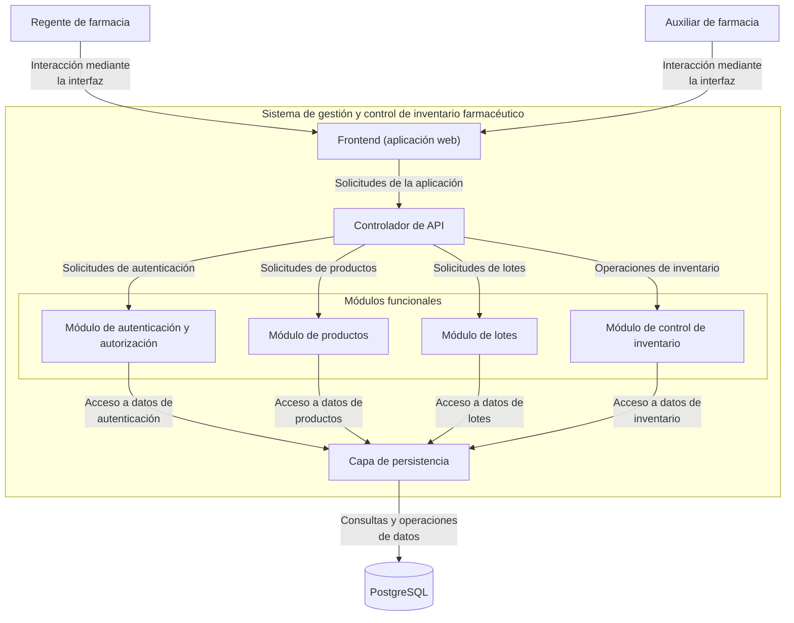

# Sistema de gestión y control de inventario farmacéutico — Diseño arquitectónico y detallado v1.0

| Campo | Información |
|---|---|
| **Equipo** | Equipo 6 |
| **Integrantes** | Junior Andrés Arrieta Tabaco, Edgar Mauricio Montufar Molano, Kevin Alexis Bermúdez Caicedo y Antonio José Moreno López |
| **Estado** | Listo para revisión |
| **Fecha** | 17/10/2026 |
| **Fuentes de entrada** | docs/req/, docs/requirements/ (REQ-RF-03.md) y los apuntes y materiales de las clases 11 y 12 proporcionados por el profesor. |

---

## 1. Visión general del sistema y controladores de diseño

**Propósito del sistema**

> Permite que el regente y auxiliar de farmacia gestionen el inventario de productos y lotes con sus fechas de vencimiento, garantizando el control estricto de entradas y salidas para evitar la distribución de medicamentos no disponibles o vencidos.

| Requisito / ID de Caso de Uso | Por qué da forma a la estructura | Atributo de calidad, restricción o regla de negocio implicada |
|---|---|---|
| RF-03 / CU-03 | El contador de intentos fallidos, el temporizador de 5 minutos y la restricción de acceso deben gestionarse centralizadamente en el backend para evitar que el cliente se la salte. | Restricción REST-01: gestión en backend. Norma de negocio RN-01: máximo 5 intentos fallidos consecutivos. Calidad: seguridad de acceso. |
| RF-02 / CU-02 | El estado de un lote debe ser verificado en un solo lugar antes de permitir cualquier movimiento de salida de inventario. | Norma de negocio: las unidades de un lote bloqueado no pueden registrarse como disponibles para salida. Calidad: integridad de datos. |
---

---

## 2. Diseño arquitectónico

### 2.1 Contexto y límites del sistema

| Elemento externo al sistema | Tipo (actor / sistema externo / hardware) | Cómo interactúa el sistema con él |
|---|---|---|
| Regente de farmacia | Actor | Se autentica en la aplicación web para acceder al sistema. Puede controlar el inventario, registrar productos, añadir productos al inventario, registrar salidas de productos y marcar lotes como bloqueados. El sistema controla sus intentos fallidos de autenticación y bloquea temporalmente su acceso cuando alcanza el límite establecido. |
| Auxiliar de farmacia | Actor | Se autentica en la aplicación web. Puede registrar productos, ingresar productos al inventario y registrar salidas de productos del inventario. El sistema controla sus intentos fallidos de autenticación y bloquea temporalmente su acceso cuando alcanza el límite establecido. |

### 2.2 Componentes, responsabilidades y capacidades

El sistema contempla los requisitos funcionales RF-02 (bloqueo de lotes) y RF-03 (bloqueo temporal de acceso por intentos fallidos de autenticación). Su arquitectura cuenta con dos actores externos: el regente de farmacia y el auxiliar de farmacia. Ambos interactúan con el sistema mediante un **frontend (aplicación web)**, que se comunica con una **API** encargada de dirigir las solicitudes a los módulos. Estos módulos se conectan con una **capa de persistencia**, responsable de gestionar el acceso a la base de datos PostgreSQL.

#### Diagrama de componentes




#### Responsabilidades y capacidades

| Componente | Responsabilidad principal | Requisitos / casos de uso que soporta | Capacidades proporcionadas | Capacidades requeridas | Dependencias principales |
|---|---|---|---|---|---|
| Frontend (aplicación web) | Proporcionar la interfaz de interacción entre los usuarios y el sistema. | RF-02, RF-03; CU-02, CU-03. | Presentar el inicio de sesión y permitir a ambos roles registrar productos, entradas y salidas del inventario, reflejando los cambios y mostrando confirmaciones. El regente también puede bloquear lotes. El sistema informa sobre bloqueos temporales por intentos fallidos de autenticación. | Servicios de autenticación y operaciones de inventario mediante la API. | Controlador de API. |
| Controlador de API | Recibir las solicitudes del frontend y dirigirlas al módulo correspondiente. | RF-02, RF-03; CU-02, CU-03. | Gestionar las solicitudes de autenticación, bloqueo de lotes, productos e inventario. | Operaciones ofrecidas por los módulos. | Módulo de autenticación y autorización, módulo de productos, módulo de lotes y módulo de control de inventario. |
| Módulo de autenticación y autorización | Validar las credenciales, controlar los intentos fallidos y aplicar las restricciones de acceso. | RF-03; CU-03. | Validar credenciales, controlar los intentos consecutivos fallidos y bloquear temporalmente el acceso durante cinco minutos después de cinco intentos fallidos consecutivos. | Consultar la base de datos para validar las credenciales y consultar o actualizar la cantidad de intentos fallidos y la fecha y hora hasta la que se bloquea el acceso. | Capa de persistencia. |
| Módulo de productos | Gestionar el registro y la consulta de los productos del sistema. | RF-02; CU-02. | Registrar nuevos productos y consultar la información de los productos existentes. | Guardar y consultar los datos de los productos mediante la capa de persistencia y solicitar al módulo de lotes la asociación de los lotes correspondientes. | Capa de persistencia y módulo de lotes. |
| Módulo de lotes | Gestionar la información y el estado de los lotes de productos farmacéuticos. | RF-02; CU-02. | Consultar los lotes y registrar el estado de bloqueo de un lote. | Acceso a los datos de los lotes y actualización de su estado. | Capa de persistencia. |
| Módulo de control de inventario | Gestionar las entradas y salidas de productos del inventario. | RF-02; CU-02. | Registrar entradas y salidas de productos, actualizar las existencias disponibles y verificar que los lotes bloqueados no se registren como disponibles para salida. | Consulta del estado de los lotes y acceso a los datos de inventario. | Módulo de lotes y capa de persistencia. |
| Capa de persistencia | Facilitar a los módulos del sistema el acceso a la base de datos para consultar, guardar y actualizar información. | Soporte a RF-02 y RF-03. | Consultar y almacenar información de productos, lotes, inventario y los datos necesarios para gestionar la autenticación y los bloqueos temporales. | Una base de datos que permita guardar, consultar y actualizar la información del sistema. | PostgreSQL. |
| PostgreSQL | Almacenar de forma persistente la información del sistema. | Soporte a RF-02 y RF-03. | Conservar y recuperar los datos solicitados por la capa de persistencia. | Consultas y operaciones de lectura y escritura. | Capa de persistencia. |

*Verificaciones del diseño:*

- Cada componente tiene una responsabilidad identificable y relacionada con el funcionamiento del sistema.
- El módulo de autenticación y autorización controla los intentos fallidos desde el backend, sin depender exclusivamente del navegador.
- El contador de intentos fallidos consecutivos debe reiniciarse después de una autenticación exitosa.
- El módulo de lotes administra el estado de bloqueo, mientras que el módulo de control de inventario verifica dicho estado e impide registrar como disponibles para salida las unidades pertenecientes a lotes bloqueados.
- La capa de persistencia separa el acceso a los datos de la lógica de los módulos funcionales.
- Los módulos se comunican a través del controlador de API y la capa de persistencia según las responsabilidades definidas en la arquitectura.
- La estrategia concreta para conservar el estado de los intentos fallidos y la duración del bloqueo ante un reinicio del servidor deberá definirse en el diseño detallado.

---

## 3. Diseño detallado

### 3.1 Componentes seleccionados

| Componente | Justificación de la selección (riesgo, complejidad, importancia para los objetivos de diseño) |
|---|---|
| **Módulo de autenticación y autorización** | Se selecciona porque verifica la identidad de los usuarios y controla sus permisos según su rol. Debe gestionar el bloqueo temporal de cinco minutos después de cinco intentos consecutivos fallidos. Un error podría permitir accesos no autorizados o bloquear usuarios legítimos. |
| **Módulo de lotes** | Se selecciona porque administra los lotes y sus estados. Es fundamental para garantizar que los lotes bloqueados no puedan utilizarse para registrar salidas de inventario. Un error podría permitir movimientos no autorizados. |
| **Módulo de control de inventario** | Se selecciona porque gestiona las entradas, las salidas y los movimientos de inventario. Debe validar la cantidad disponible y comprobar que el lote no esté bloqueado antes de registrar una salida, evitando inconsistencias en las cantidades. |
| **Capa de persistencia** | Se selecciona porque permite almacenar y recuperar los datos mediante repositorios especializados y PostgreSQL. Es esencial para conservar la información de productos, lotes, movimientos, usuarios y estados de autenticación, evitando pérdidas e inconsistencias. |

### 3.2 Diagrama de clases


### 3.3 Responsabilidades de las clases

| Clase | Componente al que pertenece | Responsabilidad | Colaboradores principales |
|---|---|---|---|
| `ServicioAutenticacion` | Módulo de autenticación y autorización | Autenticar usuarios, verificar permisos y gestionar el proceso de acceso. | `UsuarioRepository`, `RepositorioEstadoAutenticacion`, `Usuario`, `EstadoAutenticacion`, `ResultadoAutenticacion` |
| `Usuario` | Módulo de autenticación y autorización | Representar al usuario, verificar sus credenciales y consultar sus permisos. | `Rol`, `ServicioAutenticacion` |
| `Rol` | Módulo de autenticación y autorización | Agrupar los permisos asignados a un rol. | `Permiso`, `Usuario` |
| `Permiso` | Módulo de autenticación y autorización | Representar una autorización específica dentro del sistema. | `Rol` |
| `EstadoAutenticacion` | Módulo de autenticación y autorización | Registrar los intentos fallidos y determinar si el acceso está temporalmente bloqueado. | `ServicioAutenticacion`, `RepositorioEstadoAutenticacion` |
| `ResultadoAutenticacion` | Módulo de autenticación y autorización | Representar el resultado de un intento de autenticación. | `ServicioAutenticacion`, `Usuario` |
| `ServicioProducto` | Módulo de productos | Registrar y consultar productos farmacéuticos. | `ProductoRepository`, `ServicioAutenticacion`, `Producto` |
| `Producto` | Módulo de productos | Representar los datos principales de un producto farmacéutico. | `Lote`, `ServicioProducto` |
| `ServicioLote` | Módulo de lotes | Consultar lotes y gestionar el bloqueo de un lote, verificando los permisos correspondientes. | `LoteRepository`, `ServicioAutenticacion`, `Lote` |
| `Lote` | Módulo de lotes | Representar un lote, su cantidad disponible, estado y condiciones para permitir una salida. | `Producto`, `Usuario`, `EstadoLote`, `ServicioLote`, `ServicioInventario` |
| `EstadoLote` | Módulo de lotes | Definir los estados posibles de un lote: disponible o bloqueado. | `Lote` |
| `ServicioInventario` | Módulo de control de inventario | Registrar entradas y salidas, validar las condiciones del lote y generar los movimientos correspondientes. | `LoteRepository`, `ServicioLote`, `RepositorioMovimiento`, `ServicioAutenticacion`, `MovimientoInventario` |
| `MovimientoInventario` | Módulo de control de inventario | Representar cada movimiento registrado, incluyendo tipo, cantidad, fecha y observación. | `Lote`, `Usuario`, `TipoMovimiento` |
| `TipoMovimiento` | Módulo de control de inventario | Definir los tipos de movimiento contemplados en el diseño. | `MovimientoInventario` |
| `ProductoRepository` | Capa de persistencia | Definir las operaciones para guardar y consultar productos. | `Producto`, `ServicioProducto` |
| `LoteRepository` | Capa de persistencia | Definir las operaciones para buscar y guardar lotes. | `Lote`, `ServicioLote`, `ServicioInventario` |
| `RepositorioMovimiento` | Capa de persistencia | Definir la operación para guardar movimientos de inventario. | `MovimientoInventario`, `ServicioInventario` |
| `UsuarioRepository` | Capa de persistencia | Definir la operación para buscar usuarios por nombre de usuario. | `Usuario`, `ServicioAutenticacion` |
| `RepositorioEstadoAutenticacion` | Capa de persistencia | Definir las operaciones para consultar y guardar el estado de autenticación de un usuario. | `EstadoAutenticacion`, `ServicioAutenticacion` |


### 3.4 Comportamiento de una operación clave

**Operación seleccionada:** `registrarSalida(loteId, cantidad, usuario)`

**Descripción:** Registra una salida de inventario cuando el usuario tiene permiso, el lote no está bloqueado y existe una cantidad suficiente.

**Pseudocódigo:**

```text
función registrarSalida(loteId, cantidad, usuario):
    si no autorizar(usuario, "REGISTRAR_SALIDA"):
        retornar error("Usuario sin permisos")
    si cantidad <= 0:
        retornar error("Cantidad inválida")
    lote = consultarLote(loteId)
    si lote no existe:
        retornar error("Lote no encontrado")
    si lote.estaBloqueado():
        retornar error("El lote está bloqueado")
    si lote.cantidadDisponible < cantidad:
        retornar error("Cantidad insuficiente")
    iniciar transacción
    descontar cantidad del lote
    guardar cambios del lote
    movimiento = crear movimiento SALIDA
    guardar movimiento en el repositorio
    confirmar transacción
    retornar movimiento
```

**Resultado esperado:** Si las validaciones se cumplen, se registra el movimiento de salida y se actualiza la cantidad disponible. Si alguna validación falla, se devuelve un error y no se registra la salida.

---

## 4. Calidad del diseño — Cohesión, acoplamiento y ocultamiento de información

| Pregunta | Respuesta, con evidencia del diseño |
|---|---|
| **Cohesión:** ¿Las responsabilidades dentro de cada clase o componente están relacionadas entre sí? | Sí. Las responsabilidades están separadas por propósito: `ServicioAutenticacion` gestiona la autenticación y los permisos, `ServicioLote` administra los lotes y sus bloqueos, y `ServicioInventario` registra las entradas y salidas. Esta separación facilita comprender y mantener cada componente. |
| **Acoplamiento:** ¿Hasta qué punto se propagan los cambios de un elemento? ¿Dónde están las dependencias más fuertes? | Los servicios dependen de interfaces de repositorio para acceder a los datos, lo que reduce su dependencia de la implementación de la base de datos. Sin embargo, `ServicioInventario` depende de varios elementos, como `ServicioLote`, los repositorios y `ServicioAutenticacion`, por lo que sus cambios pueden afectar varias colaboraciones. |
| **Ocultamiento de información:** ¿Qué elementos se mantuvieron privados o internos y por qué? | Los atributos de las entidades, como `cantidadDisponible` en `Lote` y `credencialHash` en `Usuario`, se definen como privados. Así se evita su modificación directa desde otras clases y se centraliza el acceso mediante operaciones que protegen las reglas del sistema. |

**Hallazgo real del diseño y qué se cambió o se cambiaría:**

Se identificó que registrar una salida requiere validar el estado del lote, comprobar la cantidad disponible y guardar el movimiento. Si estas acciones se ejecutan por separado, podrían producirse inconsistencias en el inventario. Para evitarlo, se establece que la actualización de la cantidad y el registro del movimiento deben realizarse en una misma transacción, revirtiendo los cambios si ocurre un error.

---

## 5. Decisiones de diseño y registro de decisiones
Se requieren dos decisiones técnicas para el diseño del sistema: una a nivel de arquitectura y otra a nivel de diseño detallado. 

### Decisión A — Arquitectura (Gestión de bloqueos de seguridad)

| Elemento | Descripción |
|---|---|
| **Contexto** | El sistema debe bloquear el acceso de un usuario durante 5 minutos si falla la contraseña 5 veces seguidas (RF-03). El problema es que, si esta cuenta de errores se guarda solo en la memoria del servidor, al reiniciarse el sistema los datos se borrarían y el usuario bloqueado podría volver a intentar entrar. |
| **Decisión** | Guardar el registro de intentos fallidos y la fecha/hora de bloqueo permanentemente en la base de datos (PostgreSQL), utilizando la capa de persistencia. |
| **Justificación** | Guardar estos datos en la base de datos garantiza que el castigo (bloqueo) se cumpla sin importar si el servidor se apaga o se reinicia. Esto asegura el cumplimiento estricto de la regla de negocio y centraliza la seguridad. |
| **Concesión aceptada** | El sistema será ligerísimamente más lento al iniciar sesión, ya que cada vez que un usuario se equivoque de contraseña, el sistema tendrá que conectarse a la base de datos para sumar un intento fallido, consumiendo más recursos. |

### Decisión B — Diseño detallado (Integridad del inventario)

| Elemento | Descripción |
|---|---|
| **Contexto** | Cuando el auxiliar registra una salida de medicamentos (RF-02), el sistema tiene que hacer dos cosas juntas: 1) Restar la cantidad de la caja (Lote) y 2) Crear el registro (Movimiento) de lo que salió. Si el paso 1 funciona pero el paso 2 falla (por un error de internet o del sistema), el inventario quedará descuadrado. |
| **Decisión** | Agrupar el descuento de la cantidad del lote y el registro del movimiento de salida dentro de una única "transacción de base de datos". |
| **Justificación** | Una transacción funciona bajo la regla de "todo o nada". Si ocurre un error al intentar guardar el comprobante de salida, el sistema deshace automáticamente el descuento del lote. Esto garantiza que las cantidades en el sistema siempre sean reales y exactas. |
| **Concesión aceptada** | Mientras la transacción se está guardando, ese lote específico queda bloqueado por unos milisegundos. Si dos auxiliares intentan sacar medicamentos del mismo lote exactamente al mismo tiempo, uno de ellos tendrá que esperar un instante, lo que afecta un poco la concurrencia. |

# ADR: Persistencia del estado de autenticación y bloqueos de seguridad

## Estado
Aceptada

## Contexto
El sistema debe cumplir con el requisito de seguridad **RF-03**, el cual establece que se debe bloquear temporalmente el acceso de un usuario durante 5 minutos después de 5 intentos fallidos consecutivos de inicio de sesión. 

Si el contador de intentos y el registro del tiempo de bloqueo se gestionan únicamente en la memoria volátil del servidor (RAM), un reinicio del sistema (intencional o por falla) borraría estos datos. Esto permitiría que un atacante o un usuario bloqueado evada la restricción de seguridad y vuelva a intentar iniciar sesión inmediatamente, violando la regla de negocio.

## Decisión
Se ha decidido **almacenar el estado de autenticación de forma persistente en la base de datos PostgreSQL**, utilizando la capa de persistencia del sistema. 

El modelo de datos incluirá el registro de la cantidad de intentos fallidos consecutivos y la fecha y hora exacta hasta la cual el usuario se encuentra bloqueado. El `ServicioAutenticacion` deberá consultar y actualizar esta información en la base de datos en cada intento de inicio de sesión.

## Consecuencias

**Positivas:**
* **Cumplimiento estricto de seguridad:** Garantiza que los bloqueos temporales se respeten sin importar si el servidor se reinicia o se cae, cumpliendo a cabalidad con el RF-03.
* **Centralización:** El control de acceso queda fuertemente gestionado en el backend, evitando cualquier manipulación desde el lado del cliente (navegador).

**Negativas:**
* **Impacto en el rendimiento (leve):** Genera una carga adicional en la base de datos, ya que cada intento de inicio de sesión fallido requiere ejecutar consultas de lectura y escritura para actualizar el contador de intentos, en lugar de hacerlo instantáneamente en la memoria del servidor.

---


## 6. Trazabilidad
A continuación, se muestra cómo los dos requisitos funcionales del sistema (Control de lotes e Inventario, y Seguridad) se conectan con las partes del código que los hacen funcionar. 


| ID de Requisito | Caso de Uso | Componentes | Clases |
|---|---|---|---|
| **RF-02** | **CU-02** (Salida y bloqueo de lotes) | Frontend, API, **Módulo de Lotes**, **Módulo de Control de Inventario**, Persistencia | `ServicioLote`, `Lote`, `EstadoLote`, `ServicioInventario`, `MovimientoInventario`, `TipoMovimiento`, `LoteRepository`, `RepositorioMovimiento` |
| **RF-03** | **CU-03** (Bloqueo por intentos fallidos) | Frontend, API, **Módulo de Autenticación y Autorización**, Persistencia | `ServicioAutenticacion`, `Usuario`, `Rol`, `Permiso`, `EstadoAutenticacion`, `ResultadoAutenticacion`, `UsuarioRepository`, `RepositorioEstadoAutenticacion` |


---


 ## 7. Reflexión sobre el diseño asistido por IA

La IA recomendó revisar los riesgos asociados al requerimiento RF-03, especialmente la posibilidad de bloquear intencionalmente a usuarios legítimos, mantener el bloqueo más de cinco minutos o perder el contador de intentos tras un reinicio del servidor. El equipo evaluó estas recomendaciones y adaptó las mitigaciones al alcance del proyecto: considerar el uso de CAPTCHA, validar la duración del bloqueo desde el backend y almacenar el estado de autenticación en PostgreSQL. Se mantuvo el CAPTCHA como una medida por evaluar, mientras que la persistencia del contador y del bloqueo se incorporó a las decisiones de diseño.

---

## 8. Lista de verificacion de consistencia

- [x] Todos los componentes del diagrama aparecen en la tabla de responsabilidades y viceversa.
- [x] Cada clase pertenece a un componente identificable.
- [ ] Los componentes se nombran según sus responsabilidades, no según la tecnología que utilizan.
- [x] Ningún elemento ubicado dentro de los límites del sistema está fuera de tu control.
- [x] Las capacidades proporcionadas y requeridas coinciden entre los componentes.
- [ ] Ambas decisiones especifican un costo o una limitación real, y al menos una cuenta con un ADR (Registro de Decisión Arquitectónica).
- [x] La tabla de trazabilidad no contiene filas vacías ni componentes o clases sin relación con los requisitos.
- [x] Los diagramas se visualizan correctamente en GitHub o se incluyen imágenes exportadas de estos.
