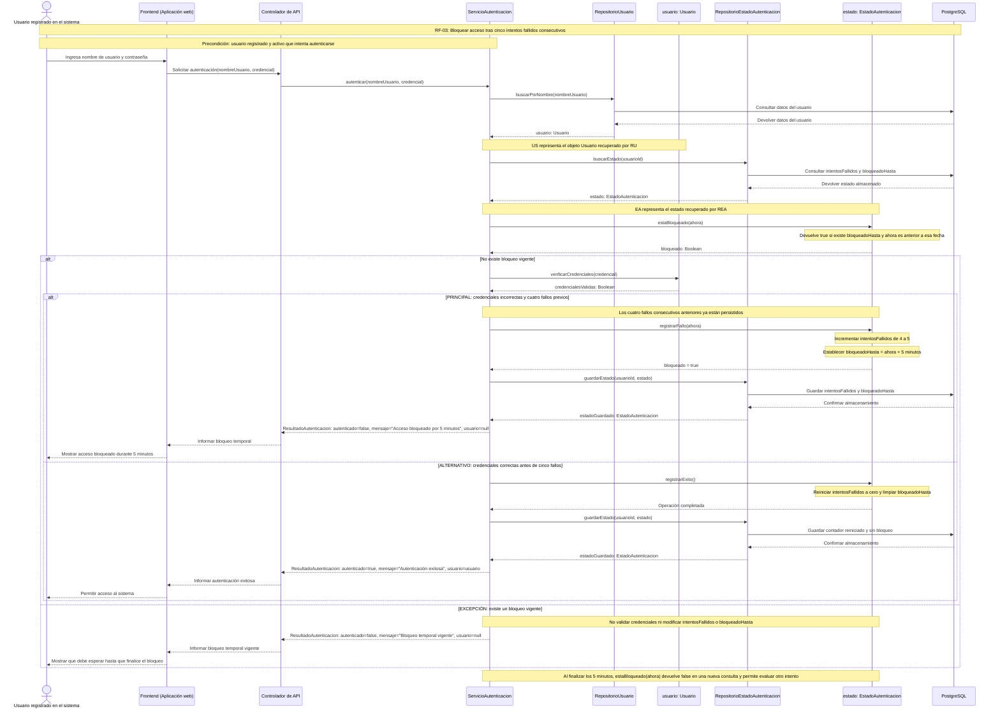
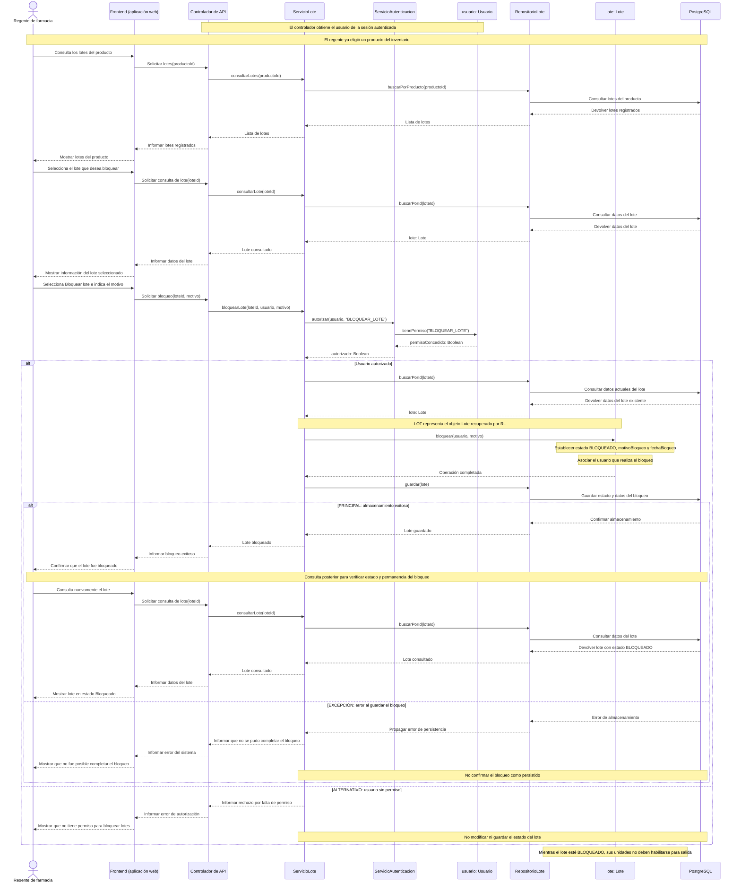
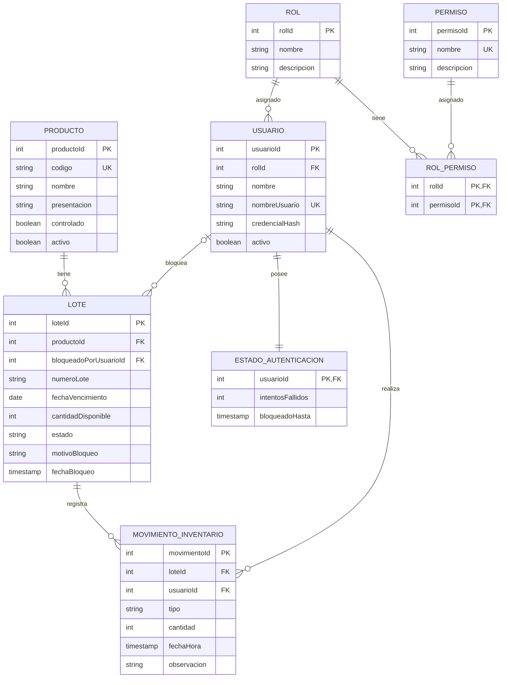

<!--
HOW TO USE THIS TEMPLATE
------------------------
1. Copy this file to docs/design/02_Interaction_and_Data_Design.md in your team repository.
2. This is v1.0 of work you started in Class 13 ("Interaction & Contracts Design v0.1").
   It builds on Deliverable 1 and must stay consistent with it. If making behavior and data
   concrete reveals a problem in Deliverable 1, update Deliverable 1 and say so in Section 4.
3. Use YOUR project. Generic examples are reference material only.
4. Sequence diagrams are derived from the Use Cases in your requirements. Do not invent
   business behavior. If something is not specified, mark it as an assumption or an Open Question.
5. If nothing in your system needs to persist, say so in Section 2.1 with your reasons. Do not
   invent a database.
6. Diagrams: Mermaid is preferred (renders on GitHub). PlantUML or another tool is accepted if
   the exported image is committed and embedded in this file.
   Optionally, also add a JPG of each diagram in docs/design/diagrams/ (the Markdown prevails if they differ).
7. Read Design_Deliverable_2_Example.md for the expected level of detail. Do not copy it.
-->

# Sistema de gestión y control de inventario para la operación de productos farmacéuticos — Diseño de Interacción y Datos v1.0

| Campo | Información |
|---|---|
| **Equipo** | Equipo 6 |
| **Integrantes** | Junior Andrés Arrieta Tabaco, Edgar Mauricio Montufar Molano, Kevin Alexis Bermúdez Caicedo y Antonio José Moreno López |
| **Estado** | Listo para revisión |
| **Fecha** | 25/10/2026 |
| **Entradas** | `docs/design/01_Diseno_Arquitectonico_y_Detallado.md`, casos de uso documentados en `docs/req/`, requisito funcional RF-02 (bloqueo de lotes de inventario), requisito funcional RF-03 (bloqueo temporal del acceso después de cinco intentos fallidos), diagrama de clases del Entregable 1 y materiales de la Clase 13 sobre diseño de interacción, datos y contratos. |

---

## 1. Comportamiento — Casos de Uso Seleccionados

### CU-03. Autenticación de usuarios — RF-03: Bloqueo temporal del acceso después de cinco intentos fallidos

El diagrama representa tres escenarios seleccionados: el flujo principal de bloqueo después del quinto intento fallido consecutivo, el flujo alternativo de autenticación exitosa y la excepción de intento durante un bloqueo vigente.

En el flujo principal, los cuatro intentos fallidos consecutivos anteriores ya se encuentran registrados en PostgreSQL. Se representa el quinto intento, que activa el bloqueo temporal.

### Correspondencia entre los flujos y las operaciones del Entregable 1

| Paso o flujo del caso de uso | Mensaje(s) en el diagrama | Información intercambiada | Operación definida en el Entregable 1 |
|---|---|---|---|
| **Flujo principal: bloqueo tras el quinto intento fallido consecutivo** | U → FE: Ingresa nombre de usuario y contraseña. FE → API: Solicitar autenticación(nombreUsuario, credencial). API → SA: autenticar(nombreUsuario, credencial). SA → RU: buscarPorNombre(nombreUsuario). SA → REA: buscarEstado(usuarioId). SA → EA: estaBloqueado(ahora). SA → US: verificarCredenciales(credencial). SA → EA: registrarFallo(ahora). EA → SA: bloqueado=true. SA → REA: guardarEstado(usuarioId, estado). REA → BD: Guardar intentosFallidos y bloqueadoHasta. REA → SA: estadoGuardado: EstadoAutenticacion. SA → API: ResultadoAutenticacion con autenticado=false y mensaje de bloqueo. API → FE: Informar bloqueo temporal. FE → U: Mostrar acceso bloqueado durante 5 minutos. | Nombre de usuario, credencial, objeto Usuario y estado de autenticación con cuatro fallos consecutivos previos. Se comprueba que no exista bloqueo vigente y que las credenciales sean incorrectas. El contador aumenta de cuatro a cinco y se establece `bloqueadoHasta = ahora + 5 minutos`. `registrarFallo(ahora)` devuelve `true`, indicando que el usuario queda bloqueado en el estado actualizado. Después se guarda el estado en PostgreSQL y `guardarEstado(...)` devuelve el objeto `EstadoAutenticacion` guardado. Solo entonces se comunica el resultado con `autenticado=false`, mensaje de bloqueo y `usuario=null`. | `ServicioAutenticacion.autenticar(nombreUsuario: String, credencial: String): ResultadoAutenticacion` `RepositorioUsuario.buscarPorNombre(nombre: String): Usuario` `RepositorioEstadoAutenticacion.buscarEstado(usuarioId: Integer): EstadoAutenticacion` `EstadoAutenticacion.estaBloqueado(ahora: Timestamp): Boolean` `Usuario.verificarCredenciales(credencial: String): Boolean` `EstadoAutenticacion.registrarFallo(ahora: Timestamp): Boolean` `RepositorioEstadoAutenticacion.guardarEstado(usuarioId: Integer, estado: EstadoAutenticacion): EstadoAutenticacion` |
| **Flujo alternativo: autenticación exitosa antes de alcanzar cinco fallos** | Se realizan la recepción de credenciales, la búsqueda del usuario y la consulta del estado. SA → EA: estaBloqueado(ahora). SA → US: verificarCredenciales(credencial). SA → EA: registrarExito(). SA → REA: guardarEstado(usuarioId, estado). REA → BD: Guardar contador reiniciado y sin bloqueo. REA → SA: estadoGuardado: EstadoAutenticacion. SA → API: ResultadoAutenticacion con autenticado=true y el usuario autenticado. API → FE: Informar autenticación exitosa. FE → U: Permitir acceso al sistema. | Credenciales válidas y estado sin bloqueo vigente. Se reinicia `intentosFallidos` a cero y se limpia `bloqueadoHasta`. `registrarExito()` conserva su retorno `void`. Se guarda el estado actualizado en PostgreSQL y `guardarEstado(...)` devuelve el objeto `EstadoAutenticacion` guardado. Después se devuelve un resultado con `autenticado=true`, mensaje de éxito y el usuario autenticado. | `ServicioAutenticacion.autenticar(nombreUsuario: String, credencial: String): ResultadoAutenticacion` `RepositorioUsuario.buscarPorNombre(nombre: String): Usuario` `RepositorioEstadoAutenticacion.buscarEstado(usuarioId: Integer): EstadoAutenticacion` `EstadoAutenticacion.estaBloqueado(ahora: Timestamp): Boolean` `Usuario.verificarCredenciales(credencial: String): Boolean` `EstadoAutenticacion.registrarExito(): void` `RepositorioEstadoAutenticacion.guardarEstado(usuarioId: Integer, estado: EstadoAutenticacion): EstadoAutenticacion` |
| **Excepción: intento de autenticación durante un bloqueo vigente** | Se realizan la recepción de credenciales, la búsqueda del usuario y la consulta del estado. SA → EA: estaBloqueado(ahora). EA → SA: bloqueado=true. SA → API: ResultadoAutenticacion con autenticado=false y mensaje de bloqueo vigente. API → FE: Informar bloqueo temporal vigente. FE → U: Mostrar que debe esperar hasta que finalice el bloqueo. | Identificación del usuario, estado almacenado y fecha de finalización del bloqueo. Se determina que el bloqueo continúa vigente y se devuelve un resultado con `autenticado=false`, mensaje de bloqueo y `usuario=null`. No se validan nuevamente las credenciales ni se modifica el estado almacenado. | `ServicioAutenticacion.autenticar(nombreUsuario: String, credencial: String): ResultadoAutenticacion` `RepositorioUsuario.buscarPorNombre(nombre: String): Usuario` `RepositorioEstadoAutenticacion.buscarEstado(usuarioId: Integer): EstadoAutenticacion` `EstadoAutenticacion.estaBloqueado(ahora: Timestamp): Boolean` |

### CU-02. Bloquear lote de inventario — RF-02: Bloquear lotes de inventario

El diagrama representa tres escenarios: bloqueo exitoso del lote, rechazo por falta de permiso y error de persistencia.

Precondiciones: el usuario está autenticado, tiene acceso al módulo de inventario y el lote seleccionado existe. Para los escenarios representados, el lote continúa existiendo durante la operación. El permiso para bloquear se comprueba en el backend.

### Correspondencia entre los flujos y las operaciones del Entregable 1

| Paso o flujo del caso de uso | Mensaje(s) en el diagrama | Información intercambiada | Operación definida en el Entregable 1 |
|---|---|---|---|
| **Flujo principal: bloqueo exitoso de un lote** | R → FE: Consulta los lotes del producto. API → SL: consultarLotes(productoId). SL → RL: buscarPorProducto(productoId). R → FE: Selecciona el lote. API → SL: consultarLote(loteId). SL → RL: buscarPorId(loteId). R → FE: Selecciona Bloquear lote e indica el motivo. API → SL: bloquearLote(loteId, usuario, motivo). SL → SA: autorizar(usuario, "BLOQUEAR_LOTE"). SA → USR: tienePermiso("BLOQUEAR_LOTE"). SL → RL: buscarPorId(loteId). SL → LOT: bloquear(usuario, motivo). SL → RL: guardar(lote). RL → BD: Guardar estado y datos del bloqueo. FE → R: Confirmar bloqueo exitoso. R → FE: Consulta nuevamente el lote. API → SL: consultarLote(loteId). SL → RL: buscarPorId(loteId). FE → R: Mostrar lote en estado Bloqueado. | Identificador del producto y del lote, usuario autenticado, permiso solicitado, motivo del bloqueo y datos del lote. Se establece el estado `BLOQUEADO`, se registran el motivo, la fecha y el usuario responsable, y se guarda el cambio en PostgreSQL. Una consulta posterior recupera el lote y muestra que permanece bloqueado. | `ServicioLote.consultarLotes(productoId: Integer): List<Lote>` `RepositorioLote.buscarPorProducto(productoId: Integer): List<Lote>` `ServicioLote.consultarLote(loteId: Integer): Lote` `RepositorioLote.buscarPorId(loteId: Integer): Lote` `ServicioLote.bloquearLote(loteId: Integer, usuario: Usuario, motivo: String): Lote` `ServicioAutenticacion.autorizar(usuario: Usuario, permiso: String): Boolean` `Usuario.tienePermiso(permiso: String): Boolean` `Lote.bloquear(usuario: Usuario, motivo: String): void` `RepositorioLote.guardar(lote: Lote): Lote` |
| **Flujo alternativo: rechazo por falta de permiso** | API → SL: bloquearLote(loteId, usuario, motivo). SL → SA: autorizar(usuario, "BLOQUEAR_LOTE"). SA → USR: tienePermiso("BLOQUEAR_LOTE"). USR → SA: false. SA → SL: false. SL → API: Informar rechazo por falta de permiso. API → FE: Informar error de autorización. FE → R: Mostrar que no tiene permiso para bloquear lotes. | Usuario autenticado, permiso `BLOQUEAR_LOTE` y resultado negativo de autorización. Se rechaza la solicitud sin modificar el lote ni guardar cambios. | `ServicioLote.bloquearLote(loteId: Integer, usuario: Usuario, motivo: String): Lote` `ServicioAutenticacion.autorizar(usuario: Usuario, permiso: String): Boolean` `Usuario.tienePermiso(permiso: String): Boolean` |
| **Excepción: error al guardar el bloqueo** | SL → RL: guardar(lote). RL → BD: Guardar estado y datos del bloqueo. BD → RL: Error de almacenamiento. RL → SL: Propagar error de persistencia. SL → API: Informar que no se pudo completar el bloqueo. API → FE: Informar error del sistema. FE → R: Mostrar que no fue posible completar el bloqueo. | Datos del lote con el bloqueo preparado y error producido al intentar almacenarlos en PostgreSQL. El error se propaga hasta la interfaz y no se confirma el bloqueo como persistido. | `RepositorioLote.guardar(lote: Lote): Lote` `ServicioLote.bloquearLote(loteId: Integer, usuario: Usuario, motivo: String): Lote` |

## 2. Diseño de datos

### 2.1 Información principal que necesita el sistema

| Información | Necesitada por (casos de uso) | ¿Persistida? | ¿Por qué (o por qué no)? |
|---|---|---|---|
| Datos de los usuarios | CU-02, CU-03 | Sí | Permiten identificar a los usuarios registrados, verificar sus credenciales y relacionarlos con las operaciones que realizan. Las contraseñas se conservan mediante un hash, no en texto plano. |
| Roles y permisos | CU-02, CU-03 | Sí | Permiten comprobar qué operaciones puede realizar cada usuario. En CU-02 se verifica el permiso `BLOQUEAR_LOTE` antes de modificar el lote. |
| Estado de autenticación | CU-03 | Sí | Permite conservar `intentosFallidos` y `bloqueadoHasta`, de modo que los intentos acumulados y el bloqueo temporal no se pierdan al reiniciar el servidor. |
| Datos de los productos | CU-02 | Sí | Permiten identificar el producto seleccionado y consultar los lotes asociados a él. |
| Datos de los lotes | CU-02 | Sí | Permiten identificar cada lote y conservar su producto, número de lote, fecha de vencimiento, cantidad disponible y estado. |
| Información del bloqueo del lote | CU-02 | Sí | Permite conservar el estado `BLOQUEADO`, el motivo, la fecha y la referencia al usuario que realizó el bloqueo. Esta información forma parte del lote. |
| Movimientos de inventario | Operaciones de inventario relacionadas con CU-02 en el Entregable 1 | Sí | Permiten conservar el historial de movimientos de los lotes. Bloquear un lote no crea por sí mismo un movimiento; la restricción de salida se comprueba al intentar registrar una salida de inventario. |
| Resultado de autenticación | CU-03 | No, como registro independiente | `ResultadoAutenticacion` comunica el resultado mediante `autenticado`, `mensaje` y la referencia opcional a `usuario`. El estado de seguridad que debe conservarse se almacena en `EstadoAutenticacion`. |
| Información del lote mostrada en pantalla | CU-02 | No, como copia persistente independiente | El frontend muestra los datos obtenidos mediante la API. PostgreSQL conserva la información persistente del lote; la información mostrada debe actualizarse mediante nuevas consultas cuando corresponda. |

### 2.2 Modelo de datos

Se utiliza un modelo relacional porque el sistema necesita conservar información estructurada sobre productos, lotes, usuarios, permisos y movimientos de inventario, manteniendo relaciones consistentes entre ellos.

PostgreSQL almacena los datos de forma persistente y permite aplicar claves primarias, claves foráneas, restricciones de unicidad y validaciones sobre los valores almacenados. Las reglas de autorización y de bloqueo temporal se ejecutan en el backend; la base de datos conserva sus resultados.

#### Modelo relacional

**Descripción del modelo:**

- `Producto` almacena la información general de cada producto farmacéutico. Cada producto puede tener cero o varios lotes y cada lote pertenece a un único producto.
- `Lote` almacena los datos específicos de cada lote, su cantidad disponible y su estado. Los campos `motivoBloqueo`, `fechaBloqueo` y `bloqueadoPorUsuarioId` conservan la información del bloqueo.
- `bloqueadoPorUsuarioId` es una clave foránea opcional que referencia a `Usuario`. Un lote sin bloqueo puede no tener un usuario asociado a esta operación; un lote bloqueado debe conservar la referencia a quien lo bloqueó.
- `MovimientoInventario` conserva los movimientos asociados a un lote y al usuario que los realiza. El bloqueo del lote no genera automáticamente un movimiento de inventario.
- `Usuario`, `Rol` y `Permiso` representan a los usuarios y las autorizaciones del sistema. Cada usuario tiene un rol y cada rol puede estar asignado a varios usuarios.
- `RolPermiso` es una tabla intermedia que permite asignar varios permisos a un rol y utilizar un mismo permiso en distintos roles.
- `EstadoAutenticacion` conserva `intentosFallidos` y `bloqueadoHasta`. Se establece un registro de estado por usuario, identificado mediante `usuarioId`, que funciona como clave primaria y clave foránea.
- `bloqueadoHasta` puede ser nulo cuando no existe un bloqueo establecido. Una fecha almacenada no implica por sí sola un bloqueo vigente: el backend debe compararla con la hora actual.
- Los campos temporales representan instantes y deben almacenarse e interpretarse de forma consistente. Para su implementación en PostgreSQL se utilizará `timestamp with time zone` (`timestamptz`).

#### Entidades y restricciones

| Entidad / tipo de documento | Significado en el sistema | Identificador | Restricciones (requeridos, únicos, valores permitidos) |
|---|---|---|---|
| `Producto` | Representa un producto farmacéutico. | `productoId` | Clave primaria obligatoria. `codigo` debe ser obligatorio y único. Deben conservarse los datos generales definidos en el modelo de clases. |
| `Lote` | Representa un lote perteneciente a un producto. | `loteId` | Clave primaria obligatoria. `productoId` debe referenciar un producto existente. `numeroLote`, `fechaVencimiento`, `cantidadDisponible` y `estado` son obligatorios. La cantidad debe ser un entero mayor o igual que cero. El estado solo puede ser `DISPONIBLE` o `BLOQUEADO`. Si está `BLOQUEADO`, deben existir un usuario responsable, un motivo no vacío y una fecha de bloqueo. |
| `MovimientoInventario` | Representa un movimiento realizado sobre un lote. | `movimientoId` | Clave primaria obligatoria. Debe referenciar un lote y un usuario existentes. `cantidad` debe ser un entero positivo para las operaciones de entrada y salida. `tipo` debe corresponder a `ENTRADA`, `SALIDA` o `AJUSTE`, según `TipoMovimiento`. Las reglas específicas de los ajustes deberán definirse antes de implementar esa operación. |
| `Usuario` | Representa a un usuario registrado en el sistema. | `usuarioId` | Clave primaria obligatoria. `nombreUsuario` debe ser obligatorio y único. `credencialHash` es obligatorio y no debe contener la contraseña en texto plano. `rolId` debe referenciar un rol existente. `activo` indica si la cuenta está habilitada. |
| `Rol` | Representa un conjunto de permisos asignado a los usuarios. | `rolId` | Clave primaria obligatoria. Debe tener un nombre obligatorio y no vacío. |
| `Permiso` | Representa una acción que puede autorizarse dentro del sistema. | `permisoId` | Clave primaria obligatoria. El nombre del permiso debe ser obligatorio y único. `BLOQUEAR_LOTE` identifica el permiso utilizado en CU-02. |
| `RolPermiso` | Representa la asignación de un permiso a un rol. | `rolId` y `permisoId` | Ambos campos son obligatorios y deben referenciar registros existentes. Forman una clave primaria compuesta que impide repetir la misma asignación. |
| `EstadoAutenticacion` | Representa el estado de seguridad asociado a un usuario. | `usuarioId` | Clave primaria y foránea que referencia a un usuario existente. `intentosFallidos` es obligatorio, comienza en cero y se mantiene entre cero y cinco. `bloqueadoHasta` puede ser nulo. El backend establece el bloqueo de cinco minutos al registrar el quinto fallo consecutivo y no incrementa el contador durante un bloqueo vigente. |

### 2.3 Propiedad de los datos

La propiedad indica qué componente controla las reglas de modificación de la información. Los repositorios proporcionan acceso a la persistencia, pero no sustituyen las responsabilidades de los módulos funcionales.

| Información | Propietario autorizado (componente responsable de mantenerla) | Consumido por (lo utiliza sin ser propietario) | Acceso a través de |
|---|---|---|---|
| Datos de los usuarios | Módulo de autenticación y autorización | Módulos de productos, lotes y control de inventario, cuando necesitan identificar o autorizar al usuario | `ServicioAutenticacion` utiliza `RepositorioUsuario` para recuperar al usuario. La comprobación de credenciales se delega en `Usuario.verificarCredenciales(credencial)`. |
| Roles y permisos | Módulo de autenticación y autorización | Módulos de productos, lotes y control de inventario | `ServicioAutenticacion.autorizar(usuario, permiso)`, que utiliza `Usuario.tienePermiso(permiso)`. |
| Estado de autenticación | Módulo de autenticación y autorización | Controlador de API y frontend, que reciben el resultado de la autenticación | `ServicioAutenticacion` consulta y guarda el estado mediante `RepositorioEstadoAutenticacion`. La API y el frontend reciben el resultado necesario para informar al usuario, sin administrar directamente el contador ni el bloqueo. |
| Datos de los productos | Módulo de productos | Frontend y funcionalidades que necesitan identificar los productos asociados a los lotes | `ServicioProducto`, mediante `RepositorioProducto`. |
| Datos y estado de los lotes | Módulo de lotes, para la consulta y el bloqueo; módulo de control de inventario, para modificar cantidades mediante movimientos | Frontend y funcionalidades de inventario que necesitan comprobar las condiciones del lote | `ServicioLote` consulta y bloquea lotes mediante `RepositorioLote`. `ServicioInventario` valida y actualiza las cantidades mediante las colaboraciones y los repositorios definidos en el Entregable 1. |
| Motivo y fecha de bloqueo del lote | Módulo de lotes | Frontend y componentes autorizados que consulten la información del lote | `ServicioLote.consultarLote(loteId)` y `ServicioLote.consultarLotes(productoId)`, mediante `RepositorioLote`. |
| Usuario asociado al bloqueo del lote | Módulo de lotes, como parte de los datos del bloqueo | Frontend y componentes autorizados que necesiten identificar al responsable | `ServicioLote` conserva la relación con `Usuario` al ejecutar el bloqueo y la persiste mediante `RepositorioLote`. |
| Movimientos de inventario | Módulo de control de inventario | Funcionalidades autorizadas de seguimiento del inventario | `ServicioInventario` registra los movimientos mediante `RepositorioMovimiento.guardar(movimiento)`. El modelo actual no define una operación de consulta del historial en este repositorio. |

### 2.4 Reglas de negocio e invariantes aplicadas a los datos

Para completar el comportamiento posterior al vencimiento del bloqueo de autenticación, este diseño incorpora una regla de reinicio del ciclo de intentos. Esta precisión deberá mantenerse también en la documentación de RF-03.

| Regla de negocio o invariante | Dónde se aplica (lógica del componente, restricción de datos o ambas) | Cómo se aplica |
|---|---|---|
| Un lote debe estar asociado a un producto existente. | Ambas | La lógica que registra o modifica la asociación debe respetar esta condición y PostgreSQL la garantiza mediante la clave foránea `productoId`. |
| El estado de un lote solo puede ser `DISPONIBLE` o `BLOQUEADO`. | Ambas | `Lote` utiliza los valores de `EstadoLote` y PostgreSQL aplica una restricción que impide almacenar otros valores. |
| Las unidades de un lote bloqueado no pueden utilizarse para registrar una salida de inventario. | Lógica del componente | `ServicioInventario` comprueba el estado mediante `Lote.estaBloqueado()` y valida las condiciones de salida antes de descontar unidades o registrar el movimiento. Esta comprobación corresponde al proceso de registrar una salida, no a una rama adicional de CU-02. |
| El bloqueo de un lote debe conservar el motivo, la fecha y el usuario responsable. | Ambas | `ServicioLote` invoca `Lote.bloquear(usuario, motivo)` y guarda el resultado mediante `RepositorioLote.guardar(lote)`. La base de datos exige los datos del bloqueo cuando el estado es `BLOQUEADO` y valida la referencia `bloqueadoPorUsuarioId`. |
| El estado bloqueado debe conservarse después de guardar y consultar nuevamente el lote. | Lógica del componente y persistencia | El estado se almacena en PostgreSQL y las consultas posteriores recuperan `BLOQUEADO`. El alcance actual no contempla una operación de desbloqueo. |
| Solo un usuario con el permiso `BLOQUEAR_LOTE` puede bloquear un lote. | Lógica del componente | `ServicioLote` solicita `ServicioAutenticacion.autorizar(usuario, "BLOQUEAR_LOTE")` antes de invocar `Lote.bloquear(usuario, motivo)`. Si la autorización falla, no modifica ni guarda el lote. |
| Bloquear un lote no modifica su cantidad disponible ni genera un movimiento de inventario. | Lógica del componente | `Lote.bloquear(usuario, motivo)` modifica los datos del bloqueo. No descuenta unidades ni invoca el registro de movimientos. |
| La cantidad disponible de un lote no puede ser negativa. | Ambas | `ServicioInventario` valida las cantidades y las existencias. PostgreSQL aplica una restricción que impide almacenar una cantidad negativa. |
| Una salida debe respetar el bloqueo y la cantidad disponible del lote. | Lógica del componente y persistencia | `ServicioInventario` vuelve a comprobar las condiciones del lote dentro de la transacción antes de actualizarlo. El descuento de unidades y el registro del movimiento se confirman juntos; si falla alguno, se revierten los cambios de la transacción. |
| Las asignaciones de permisos deben referenciar roles y permisos existentes y no repetirse. | Ambas | La gestión de asignaciones debe validar sus referencias. PostgreSQL utiliza claves foráneas y una clave primaria compuesta en `RolPermiso`. La autorización consulta los permisos asignados; no crea esas asignaciones. |
| El quinto intento fallido consecutivo debe bloquear el acceso durante cinco minutos. | Lógica del componente y persistencia | `EstadoAutenticacion.registrarFallo(ahora)` incrementa `intentosFallidos` y, al llegar a cinco, establece `bloqueadoHasta = ahora + 5 minutos`. `ServicioAutenticacion` guarda el estado mediante `RepositorioEstadoAutenticacion` antes de confirmar el bloqueo. |
| Un bloqueo vigente impide volver a validar las credenciales. | Lógica del componente | `ServicioAutenticacion` consulta `EstadoAutenticacion.estaBloqueado(ahora)` antes de llamar a `Usuario.verificarCredenciales(credencial)`. Si devuelve `true`, rechaza el intento sin incrementar el contador ni prolongar `bloqueadoHasta`. |
| Una autenticación exitosa reinicia el contador de intentos fallidos. | Lógica del componente y persistencia | `EstadoAutenticacion.registrarExito()` establece `intentosFallidos` en cero y limpia `bloqueadoHasta`. El servicio guarda el estado actualizado antes de devolver el resultado exitoso. |
| El bloqueo deja de estar vigente cuando se alcanza su fecha de finalización. | Lógica del componente | `estaBloqueado(ahora)` devuelve `true` únicamente cuando existe `bloqueadoHasta` y `ahora` es anterior a esa fecha. Si la fecha ya se alcanzó, permite evaluar un nuevo intento. No es necesario borrar el registro ni ejecutar una tarea periódica para comprobar el vencimiento. |
| Después de vencer un bloqueo, el siguiente intento inicia un nuevo ciclo de conteo. | Lógica del componente y persistencia | Como precisión de este diseño, si el siguiente intento falla, `registrarFallo(ahora)` reconoce el bloqueo vencido, reinicia el ciclo y registra ese intento como el primer fallo, dejando `intentosFallidos = 1` y sin bloqueo vigente. Si el intento tiene éxito, `registrarExito()` reinicia el estado. El servicio persiste el resultado. |
| El contador y el bloqueo se controlan en el backend y se conservan entre reinicios del servidor. | Lógica del componente y persistencia | El servidor calcula el tiempo y administra el estado. `RepositorioEstadoAutenticacion` guarda y recupera `intentosFallidos` y `bloqueadoHasta` en PostgreSQL, conforme a ADR-0003. |
| Un error de persistencia no debe permitir omitir el control de autenticación. | Lógica del componente y persistencia | Si no puede consultarse o guardarse el estado necesario para completar la autenticación, el sistema informa el error y no concede el acceso. Este escenario técnico se mantiene como obligación de ADR-0003, aunque no se desarrolle entre los tres escenarios seleccionados de CU-03. |
| Los datos de productos, lotes, usuarios y movimientos deben mantener relaciones consistentes. | Ambas | Los servicios validan las operaciones y PostgreSQL aplica claves foráneas y transacciones. Los cambios relacionados se confirman de forma conjunta cuando la operación lo requiere. |

---

## 3. Contrato de interfaz

Se selecciona la operación de bloqueo de lotes porque implementa el cambio de estado definido en RF-02 y conserva la información necesaria para identificar el bloqueo y a su responsable.

La restricción de salida se hace efectiva cuando `ServicioInventario` comprueba el estado del lote antes de registrar una salida. La operación de bloqueo no registra una salida ni modifica las existencias.

**Interacción seleccionada (del diagrama de CU-02, mensaje `bloquearLote(loteId, usuario, motivo)`):**

`Controlador de API → ServicioLote: bloquearLote(loteId, usuario, motivo)`

| Elemento | Especificación |
|---|---|
| **Operación y propósito** | `ServicioLote.bloquearLote(loteId: Integer, usuario: Usuario, motivo: String): Lote` solicita el bloqueo de un lote. El servicio comprueba el permiso `BLOQUEAR_LOTE`, recupera el lote, invoca `Lote.bloquear(usuario, motivo)` y guarda el cambio mediante `RepositorioLote.guardar(lote)`. El flujo principal termina con el bloqueo persistido y su confirmación. |
| **Entrada (parámetros y tipos)** | `loteId: Integer`: identificador del lote que se desea bloquear. `usuario: Usuario`: objeto que representa al usuario autenticado y que el controlador obtiene del contexto de autenticación; no se acepta como prueba de identidad un usuario enviado libremente por el frontend. `motivo: String`: motivo del bloqueo, obligatorio y no vacío. |
| **Salida (resultado exitoso y estructura de datos)** | Devuelve un objeto `Lote` con `estado = BLOQUEADO`, `motivoBloqueo`, `fechaBloqueo` y la relación con el usuario responsable. En PostgreSQL, esta relación se representa mediante `bloqueadoPorUsuarioId`. Conserva el identificador, producto, número de lote, vencimiento y cantidad disponible. El servicio devuelve el resultado exitoso únicamente después de confirmar el almacenamiento. El controlador presenta al frontend los datos necesarios, sin exponer `credencialHash`. |
| **Precondiciones (qué debe cumplir quien invoca la operación)** | El usuario debe estar autenticado y ser identificado por el controlador. Deben proporcionarse un `loteId` válido y un motivo no vacío. La autorización y la existencia actual del lote se comprueban en el servicio como condiciones para completar la operación. En los tres escenarios seleccionados del diagrama se presupone que el lote existe; el contrato también contempla que una invocación pueda referenciar un lote inexistente. |
| **Postcondiciones (qué se garantiza si la operación termina correctamente)** | El lote queda persistido en estado `BLOQUEADO`, con el motivo, la fecha y la referencia al usuario responsable. Una consulta posterior recupera el estado bloqueado. Mientras permanezca así, `ServicioInventario` debe rechazar las salidas de ese lote. El bloqueo no modifica por sí mismo `cantidadDisponible` ni crea un movimiento de inventario. |
| **Resultados de fallo (cada fallo y estado posterior)** | **Usuario sin permiso — flujo alternativo representado:** se rechaza la solicitud antes de modificar el lote; no se guardan cambios. **Lote inexistente — validación adicional del contrato:** se informa que no se encontró el lote; no se modifica ningún lote. Este caso no se desarrolla como una cuarta rama del diagrama seleccionado. **Error de persistencia — excepción representada:** se informa que no fue posible completar el bloqueo y no se devuelve un resultado exitoso. La escritura de los datos del bloqueo debe ser atómica, sin cambios parcialmente confirmados. Si se modificó un objeto en memoria antes del error, no debe reutilizarse como si el bloqueo estuviera confirmado en PostgreSQL. |
| **Invariantes y efectos secundarios (qué debe mantenerse y qué puede cambiar)** | El estado solo puede tomar valores de `EstadoLote`: `DISPONIBLE` o `BLOQUEADO`. Solo un usuario autorizado puede ejecutar el bloqueo. Se conservan el motivo, la fecha y el usuario responsable. No cambian el producto asociado, el número de lote, la fecha de vencimiento ni la cantidad disponible. No se registra una salida. Las operaciones de salida deben comprobar el bloqueo antes de modificar el inventario. Los errores se comunican por el mecanismo de excepciones de la implementación; no se sustituyen por un objeto `Lote` que aparente éxito. |

### Ejemplos verificables

Los ejemplos de bloqueo exitoso, usuario sin permiso y error de persistencia corresponden a los tres escenarios del diagrama. El ejemplo de lote inexistente verifica una validación adicional del contrato de la operación.

| Caso | Estado previo | Solicitud | Resultado esperado |
|---|---|---|---|
| Bloqueo exitoso | El lote `15` existe, está `DISPONIBLE` y el usuario autenticado tiene el permiso `BLOQUEAR_LOTE`. | `bloquearLote(15, usuarioRegente, "Lote en revisión")` | Devuelve el lote en estado `BLOQUEADO` después de guardar el motivo, la fecha y la referencia al usuario responsable. Una consulta posterior muestra el bloqueo. La cantidad disponible permanece igual y no se crea un movimiento de inventario. |
| Usuario sin permiso | El lote `15` existe y está `DISPONIBLE`, pero el usuario autenticado no tiene `BLOQUEAR_LOTE`. | `bloquearLote(15, usuarioSinPermiso, "Lote en revisión")` | Se rechaza la solicitud por falta de autorización. No se invoca el bloqueo del lote ni se guardan cambios. |
| Lote inexistente | El usuario está autenticado y autorizado, pero no existe un lote con identificador `9999`. | `bloquearLote(9999, usuarioRegente, "Lote en revisión")` | Se informa que el lote no fue encontrado. No se invoca `Lote.bloquear(...)` ni se guarda ningún lote. Es una validación del contrato fuera de los tres escenarios seleccionados. |
| Error de persistencia | El lote `15` existe y está `DISPONIBLE`; el usuario está autorizado. Se simula un fallo de escritura que impide confirmar el almacenamiento. | `bloquearLote(15, usuarioRegente, "Lote en revisión")` | Se informa que no fue posible completar el bloqueo y no se devuelve un resultado exitoso. La escritura fallida no deja datos de bloqueo parcialmente confirmados. El objeto modificado en memoria se descarta o se recarga antes de volver a utilizarlo. |

---

---

## 4. Consistencia cruzada y cambios al Entregable 1

### 4.1 Lista de comprobación de consistencia

| Comprobación                                                                                                                                  | Resultado                                                                                                                                                                                                                                                                                                                                                                                                                                                                         |
| --------------------------------------------------------------------------------------------------------------------------------------------- | --------------------------------------------------------------------------------------------------------------------------------------------------------------------------------------------------------------------------------------------------------------------------------------------------------------------------------------------------------------------------------------------------------------------------------------------------------------------------------- |
| Todos los participantes de los diagramas de secuencia son actores, componentes, clases o sistemas externos definidos en el Entregable 1.      | **Cumple.** Los participantes de CU-02 y CU-03 corresponden a actores, componentes, clases y sistemas identificados en la arquitectura y el diagrama de clases, como `ServicioLote`, `ServicioAutenticacion`, `RepositorioLote`, `RepositorioUsuario`, `EstadoAutenticacion`, `Usuario`, `Lote`, el frontend, el controlador de API y PostgreSQL.                                                                                                                                 |
| Todos los mensajes corresponden a una capacidad, operación o contrato.                                                                        | **Cumple con observación.** Las llamadas principales utilizan las operaciones definidas en el diseño, como `autenticar(...)`, `buscarEstado(...)`, `bloquearLote(...)`, `bloquear(...)` y `guardar(...)`. Los mensajes de respuesta y error describen el comportamiento de los componentes y no representan necesariamente operaciones nuevas.                                                                                                                                    |
| Todas las entidades o tipos de documento están reflejados en los diagramas de clases, o se explica por qué no aparecen en el modelo de datos. | **Cumple.** Las entidades persistentes principales están representadas en el modelo relacional. `ResultadoAutenticacion` no se persiste como entidad independiente porque representa el resultado de una operación. `EstadoLote` y `TipoMovimiento` se representan mediante los valores permitidos de los atributos `estado` y `tipo`. La tabla `ROL_PERMISO` representa la relación entre roles y permisos en el modelo relacional, sin requerir una clase de dominio adicional. |
| Cada elemento de información persistente tiene exactamente un propietario autorizado.                                                         | **Cumple.** La sección 2.3 asigna la responsabilidad de mantener cada conjunto de datos a un único módulo: autenticación y autorización, productos, lotes o control de inventario. Los demás componentes acceden a la información mediante los servicios correspondientes.                                                                                                                                                                                                        |
| El contrato coincide con el diagrama de secuencia y con el modelo de datos, manteniendo el mismo comportamiento en las tres representaciones. | **Cumple con observación.** El contrato de `ServicioLote.bloquearLote(loteId, usuario, motivo)` coincide con el flujo de bloqueo del CU-02 y con el modelo relacional actualizado. La relación con el usuario que realizó el bloqueo se representa mediante `bloqueadoPorUsuarioId`.                                     |

### 4.2 Cambios realizados al Entregable 1 a partir de este entregable

No se han realizado modificaciones directas al diagrama de clases del Entregable 1 ni se han añadido nuevas operaciones a sus clases. Este entregable permitió precisar el comportamiento de los casos de uso, los contratos entre componentes y la representación relacional de la información.

Los principales ajustes y precisiones son los siguientes:

- **Comportamiento de RF-02:** se detallaron la verificación de permisos, la consulta del lote, la actualización a estado `BLOQUEADO`, la persistencia y la consulta posterior para verificar que el estado se mantenga.
- **Representación relacional del bloqueo:** se incorporó `bloqueadoPorUsuarioId` en `LOTE` para representar la asociación existente entre `Lote` y `Usuario` que identifica quién realizó el bloqueo. También se incorporó la tabla intermedia `ROL_PERMISO` para representar la relación entre roles y permisos.
- **Comportamiento de RF-03:** se documentaron la verificación de credenciales, el control de intentos fallidos, el bloqueo temporal de cinco minutos, el reinicio del contador después de una autenticación exitosa y la persistencia del estado de autenticación.
- **Propiedad de los datos:** se precisó qué módulo mantiene cada conjunto de información y cómo acceden los demás componentes mediante los servicios correspondientes.
- **Reglas de integridad:** se especificaron las condiciones que deben respetarse, especialmente la prohibición de registrar salidas de lotes bloqueados y la conservación del estado de autenticación.

---
## 5. Preguntas abiertas

* **Concurrencia en salidas de inventario:** 
  Aunque definimos que el descuento de unidades y el registro del movimiento se harán en una misma transacción de base de datos, ¿qué estrategia exacta de bloqueo a nivel de fila (por ejemplo, *bloqueo pesimista* o *bloqueo optimista*) usaremos en PostgreSQL para evitar errores si dos usuarios intentan sacar unidades del mismo lote exactamente al mismo tiempo?

* **Desbloqueo automático de usuarios:** 
  El modelo establece que guardaremos la fecha `bloqueoHasta` en PostgreSQL. ¿El sistema quitará este bloqueo automáticamente pasados los 5 minutos (usando un proceso en segundo plano o *tarea programada*), o simplemente validará el tiempo de forma dinámica cuando el usuario intente iniciar sesión de nuevo?

* **Auditoría estricta de bloqueos de lotes:** 
  Actualmente guardamos el `motivoBloqueo` y la `fechaBloqueo` directamente en la entidad `LOTE`. ¿Será necesario, por normativas farmacéuticas, crear una tabla adicional (ej. `HISTORIAL_BLOQUEO`) para tener un registro inmutable de quién y cuándo bloqueó o desbloqueó un lote en el tiempo?

---

## 6. Opcional — Reflexión sobre el diseño asistido por IA

**Recomendación de la IA:** 
Al diseñar el módulo de control de inventario, la IA sugirió implementar un patrón de "Bloqueo Optimista" (*bloqueo optimista*) agregando un campo de versión a la tabla `LOTE`. El objetivo era rechazar una salida si otro usuario modificaba la cantidad del lote un instante antes.

**Decisión del equipo (Modificada/Rechazada):** 
Decidimos **no aplicar** esa recomendación y optar por un control basado en transacciones de base de datos estrictas. Tal como documentamos, "el descuento y el registro del movimiento deben ejecutarse en una misma transacción". Consideramos que un bloqueo pesimista directo en PostgreSQL es más seguro para este dominio. Esto nos evita complejizar el código del backend con reintentos, asegurando la integridad del inventario de forma más directa y centralizada.

---

## 7. Lista de comprobación de consistencia

- [x] Dos casos de uso del proyecto, cada uno trazable a un caso de uso documentado en los requisitos.
- [x] Cada diagrama de secuencia muestra el flujo principal y al menos un flujo alternativo o de excepción.
- [x] No se inventa ningún comportamiento de negocio: todo lo no especificado se marca como supuesto o pregunta abierta.
- [x] La sección 2.1 explica qué información no se almacena de forma persistente, además de la que sí se almacena.
- [x] El modelo de datos tiene identificadores, relaciones y restricciones, no solamente entidades representadas mediante cajas.
- [x] Cada conjunto principal de información tiene un responsable definido y se indican sus consumidores en la sección 2.3.
- [x] El contrato define entradas, salidas, precondiciones, postcondiciones y resultados de error.
- [x] Los diagramas de secuencia, el modelo de datos y el contrato describen el mismo comportamiento.
- [x] Los diagramas se visualizan correctamente en GitHub o se incluyen imágenes exportadas.
