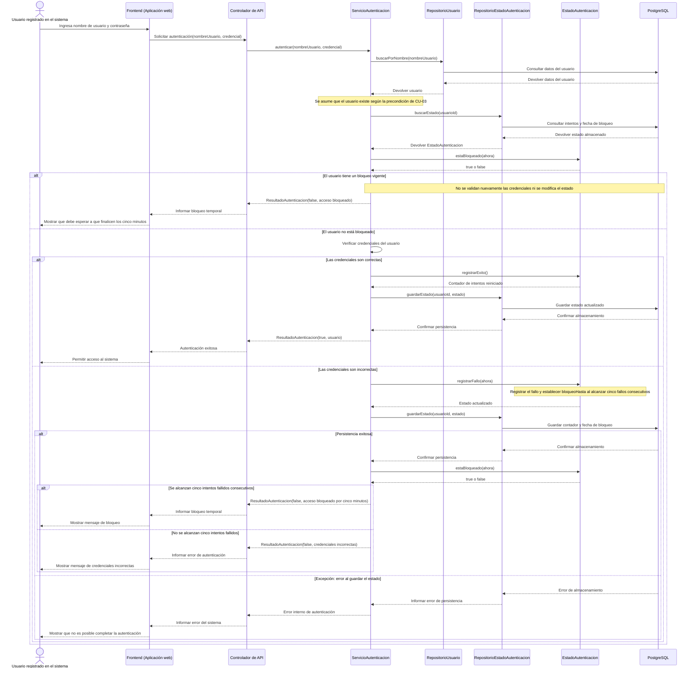
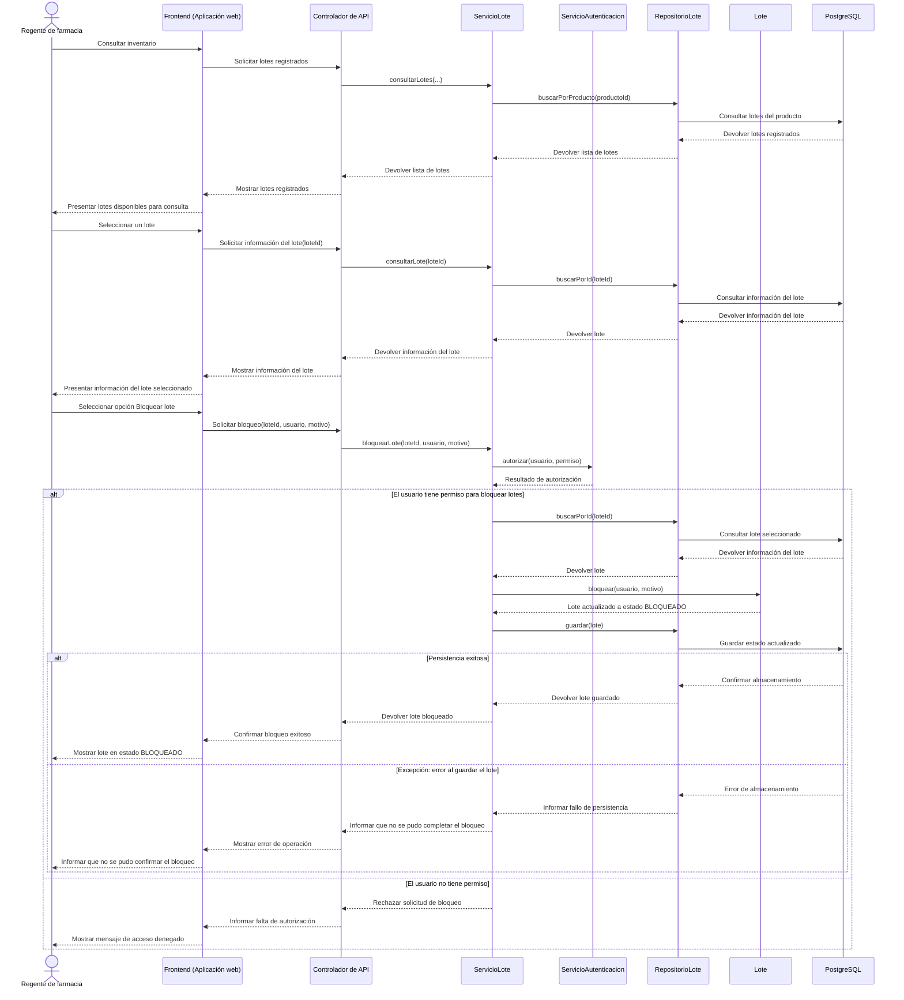
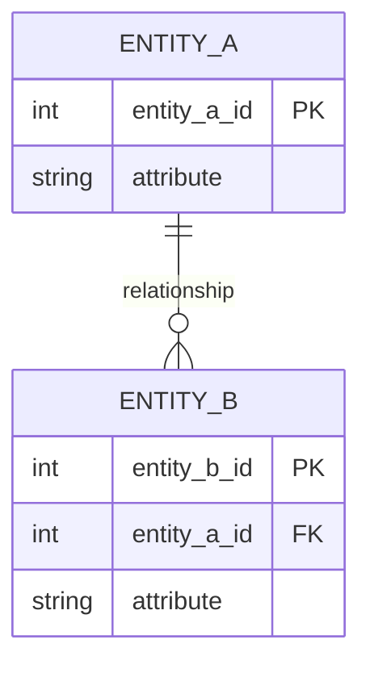

<!--
HOW TO USE THIS TEMPLATE
------------------------
1. Copy this file to docs/design/02_Interaction_and_Data_Design.md in your team repository.
2. This is v1.0 of work you started in Class 13 ("Interaction & Contracts Design v0.1").
   It builds on Deliverable 1 and must stay consistent with it. If making behavior and data
   concrete reveals a problem in Deliverable 1, update Deliverable 1 and say so in Section 4.
3. Use YOUR project. Generic examples are reference material only.
4. Sequence diagrams are derived from the Use Cases in your requirements. Do not invent
   business behavior. If something is not specified, mark it as an assumption or an Open Question.
5. If nothing in your system needs to persist, say so in Section 2.1 with your reasons. Do not
   invent a database.
6. Diagrams: Mermaid is preferred (renders on GitHub). PlantUML or another tool is accepted if
   the exported image is committed and embedded in this file.
   Optionally, also add a JPG of each diagram in docs/design/diagrams/ (the Markdown prevails if they differ).
7. Read Design_Deliverable_2_Example.md for the expected level of detail. Do not copy it.
-->

# Sistema de gestión y control de inventario para la operación de productos farmacéuticos — Diseño de Interacción y Datos v1.0

| | |
|---|---|
| **Equipo** | |
| **Integrantes** | |
| **Estado** | Borrador / Listo para revisión |
| **Fecha** | |
| **Entradas** | `docs/design/01_Architectural_and_Detailed_Design.md`, Casos de Uso en `docs/requirements/`, Diseño de Interacción y Contratos v0.1 (Clase 13) |

---

## 1. Comportamiento — Casos de Uso Seleccionados

### 1.1 [Nombre del caso de uso] — del requisito [REQ-XX]



| Paso o flujo del caso de uso | Mensaje(s) en el diagrama | Información intercambiada | Operación definida en el Entregable 1 |
|---|---|---|---|
| Flujo principal, paso 1 | `U → FE: Ingresa nombre de usuario y contraseña`<br>`FE → API: Solicitar autenticación(nombreUsuario, credencial)`<br>`API → SA: autenticar(nombreUsuario, credencial)`<br>`SA → RU: buscarPorNombre(nombreUsuario)`<br>`SA → REA: buscarEstado(usuarioId)` | Nombre de usuario, credencial y estado de autenticación almacenado, incluidos el contador de intentos fallidos y la fecha de finalización del bloqueo. | `ServicioAutenticacion.autenticar(nombreUsuario, credencial)`<br>`RepositorioUsuario.buscarPorNombre(nombre)`<br>`RepositorioEstadoAutenticacion.buscarEstado(usuarioId)` |
| Flujo alternativo | `SA → EA: estaBloqueado(ahora)`<br>`SA → EA: registrarExito()` o `registrarFallo(ahora)`<br>`SA → REA: guardarEstado(usuarioId, estado)`<br>`SA → API: ResultadoAutenticacion(...)` | Estado del bloqueo, resultado de la validación de credenciales y actualización del contador. Si la autenticación es exitosa, se reinicia el contador; si falla, se incrementa y se establece el bloqueo al alcanzar cinco intentos consecutivos. | `EstadoAutenticacion.estaBloqueado(ahora)`<br>`EstadoAutenticacion.registrarExito()`<br>`EstadoAutenticacion.registrarFallo(ahora)`<br>`RepositorioEstadoAutenticacion.guardarEstado(usuarioId, estado)` |
| Excepción | `BD → REA: Error de almacenamiento`<br>`REA → SA: Informar error de persistencia`<br>`SA → API: Error interno de autenticación`<br>`API → FE: Informar error del sistema`<br>`FE → U: Mostrar que no es posible completar la autenticación` | Error al guardar en PostgreSQL el estado actualizado de autenticación. El sistema informa que la operación no pudo completarse y no confirma el acceso como exitoso. | `RepositorioEstadoAutenticacion.guardarEstado(usuarioId, estado)` |


### 1.2 [Second Use Case name] — from requirement [REQ-YY]



| Paso o flujo del caso de uso | Mensaje(s) en el diagrama | Información intercambiada | Operación definida en el Entregable 1 |
|---|---|---|---|
| Flujo principal, paso 1 | `R → FE: Consultar inventario`<br>`FE → API: Solicitar lotes registrados`<br>`API → SL: consultarLotes(...)`<br>`SL → RL: buscarPorProducto(productoId)`<br>`RL → BD: Consultar lotes del producto` | Solicitud de consulta y lista de lotes registrados en el inventario. | `ServicioLote.consultarLotes(...)` y `RepositorioLote.buscarPorProducto(productoId)` |
| Flujo alternativo | `SL → SA: autorizar(usuario, permiso)`<br>`SA → SL: Resultado de autorización`<br>`SL → API: Rechazar solicitud de bloqueo`<br>`API → FE: Informar falta de autorización`<br>`FE → R: Mostrar mensaje de acceso denegado` | Resultado de la verificación de permisos del regente para ejecutar el bloqueo del lote. Si no tiene el permiso requerido, el sistema rechaza la solicitud. | `ServicioAutenticacion.autorizar(usuario, permiso)` |
| Excepción | `BD → RL: Error de almacenamiento`<br>`RL → SL: Informar fallo de persistencia`<br>`SL → API: Informar que no se pudo completar el bloqueo`<br>`API → FE: Mostrar error de operación`<br>`FE → R: Informar que no se pudo confirmar el bloqueo` | Error al guardar el lote con su estado actualizado en PostgreSQL. El sistema informa que no pudo confirmar la operación. | `RepositorioLote.guardar(lote)` |


---

## 2. Data Design

### 2.1 Principal information the system needs

| Information | Needed by (use cases) | Persisted? | Why (or why not) |
|---|---|---|---|
| | | Yes / No | |

*(Data owned by an external system, or recomputable on demand, is often better not persisted. If that is your decision, say so.)*

### 2.2 Data model

Choose the representation that fits your persistence approach and **justify it in one or two sentences**:
>

**Option A — Relational:** an Entity-Relationship diagram with entities, relevant attributes, primary identifiers, relationships, cardinalities and constraints.



*(Cardinality: `||` exactly one, `o|` zero or one, `}o` zero or many, `}|` one or many.)*

**Option B — Document-oriented:** collections or document types, structure, identifiers, embedded structures, references and constraints.

```json
{
  "collection_name": {
    "id": "identifier",
    "embedded_structure": [ { "field": "value" } ],
    "reference_to_other_collection": "identifier"
  }
}
```

**Other representation:** allowed if you justify why it suits your project. The goal is not to force a relational or document database. The goal is to design the information the software needs.

| Entity / document type | Meaning in the system | Identifier | Constraints (required, unique, allowed values) |
|---|---|---|---|
| | | | |

### 2.3 Data Ownership

| Information | Authoritative owner (component responsible for maintaining it) | Consumed by (uses it without owning it) | Access through |
|---|---|---|---|
| | | | |

*(Do not assume every component needs its own database. Sharing information does not mean sharing ownership. No component reads or writes another component's data directly.)*

### 2.4 Business rules and invariants enforced in data

| Business rule or invariant | Where it is enforced (component logic / data constraint / both) | How |
|---|---|---|
| | | |

---

## 3. Interface Contract

Select **one** important interaction from your sequence diagrams and specify the agreement between the two components. Technology (REST, JSON, OpenAPI) is not required.

**Interaction chosen** (from diagram 1.X, message `...`):
>

| Element | Specification |
|---|---|
| **Operation and purpose** | |
| **Input** (parameters and types) | |
| **Output** (successful result and data structure) | |
| **Preconditions** (what the caller must satisfy before invoking) | |
| **Postconditions** (what is guaranteed on successful completion) | |
| **Failure outcomes** (each failure, and what state is left after it) | |
| **Invariants and side effects** (what must stay true, what may change) | |

**Testable examples** *(optional but recommended: concrete values make guarantees checkable)*

| Case | Before | Request | Expected |
|---|---|---|---|
| | | | |

---

## 4. Cross-Consistency & Changes to Deliverable 1

| Check | Result |
|---|---|
| Every participant in a sequence diagram is an actor, a component, a class or an external system from Deliverable 1 | |
| Every message corresponds to a capability, operation or contract | |
| Every entity or document type is reflected in the class diagrams, or the reason it is not is stated | |
| Every persisted information element has exactly one authoritative owner | |
| The contract agrees with the sequence diagram and with the data model (same behavior in all three views) | |

**Changes made to Deliverable 1 because of this deliverable** *(real designs change when behavior and data become concrete. List what you updated, or write "None" and why.)*
>

---

## 5. Open Questions

> Anything unresolved about behavior or data. List it here instead of guessing.

---

## 6. Optional — AI-Assisted Design Reflection

> One design recommendation generated by AI that the team accepted, modified or rejected, and why.

---

## 7. Consistency Checklist

- [ ] Two use cases from the project, each traceable to a Use Case written in the requirements.
- [ ] Each sequence diagram shows the main flow and at least one alternative or exception flow.
- [ ] No business behavior is invented: anything unspecified is marked as an assumption or Open Question.
- [ ] Section 2.1 explains what is NOT persisted as well as what is.
- [ ] The data model has identifiers, relationships and constraints, not only boxes.
- [ ] Every piece of principal information has one authoritative owner, and consumers are listed (Section 2.3).
- [ ] The contract defines input, output, preconditions, postconditions and failure outcomes.
- [ ] Sequence, data model and contract describe the same behavior.
- [ ] Diagrams render correctly on GitHub (or the exported images are embedded).
