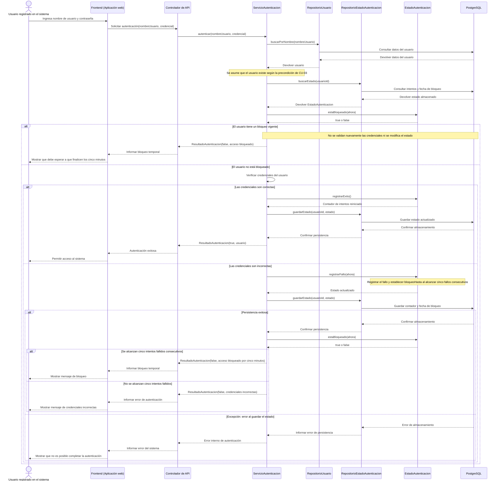
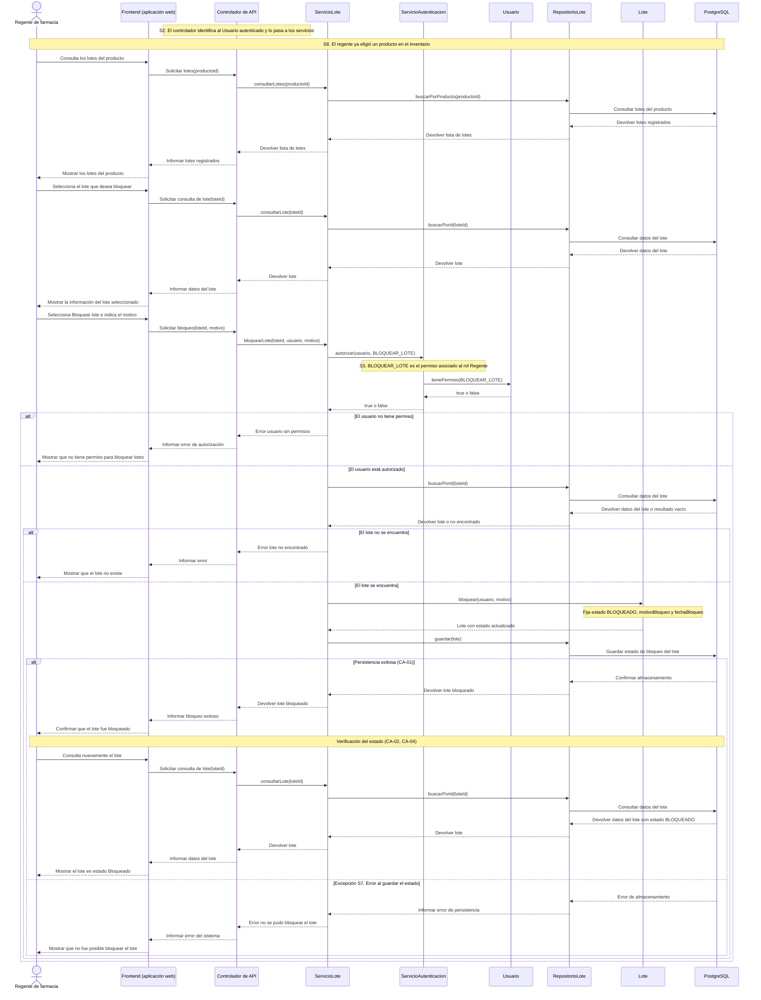
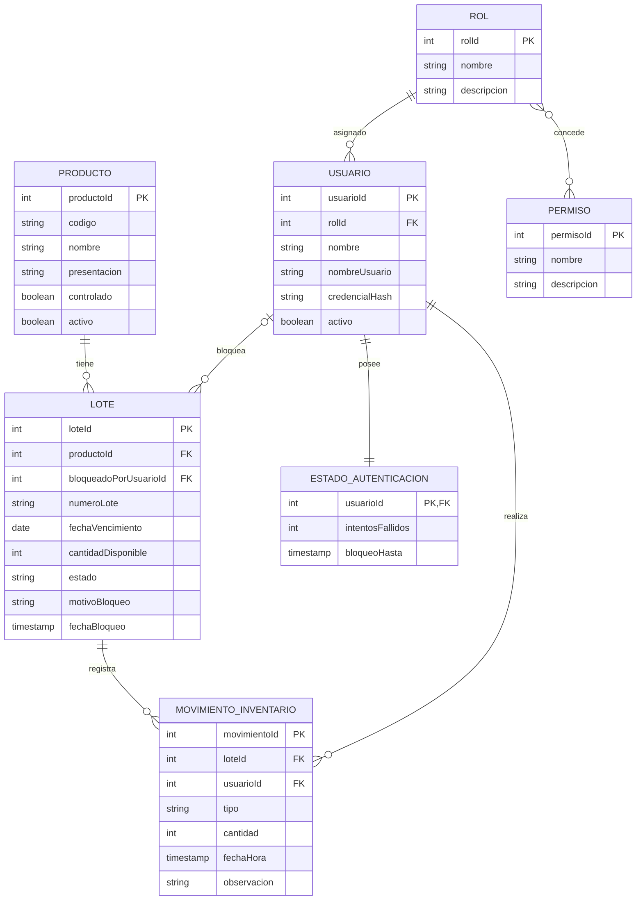

<!--
HOW TO USE THIS TEMPLATE
------------------------
1. Copy this file to docs/design/02_Interaction_and_Data_Design.md in your team repository.
2. This is v1.0 of work you started in Class 13 ("Interaction & Contracts Design v0.1").
   It builds on Deliverable 1 and must stay consistent with it. If making behavior and data
   concrete reveals a problem in Deliverable 1, update Deliverable 1 and say so in Section 4.
3. Use YOUR project. Generic examples are reference material only.
4. Sequence diagrams are derived from the Use Cases in your requirements. Do not invent
   business behavior. If something is not specified, mark it as an assumption or an Open Question.
5. If nothing in your system needs to persist, say so in Section 2.1 with your reasons. Do not
   invent a database.
6. Diagrams: Mermaid is preferred (renders on GitHub). PlantUML or another tool is accepted if
   the exported image is committed and embedded in this file.
   Optionally, also add a JPG of each diagram in docs/design/diagrams/ (the Markdown prevails if they differ).
7. Read Design_Deliverable_2_Example.md for the expected level of detail. Do not copy it.
-->

# Sistema de gestión y control de inventario para la operación de productos farmacéuticos — Diseño de Interacción y Datos v1.0

| Campo | Información |
|---|---|
| **Equipo** | Equipo 6 |
| **Integrantes** | Junior Andrés Arrieta Tabaco, Edgar Mauricio Montufar Molano, Kevin Alexis Bermúdez Caicedo y Antonio José Moreno López |
| **Estado** | Listo para revisión |
| **Fecha** | 25/10/2026 |
| **Entradas** | `docs/design/01_Architectural_and_Detailed_Design.md`, casos de uso documentados en `docs/requirements/`, requisito funcional RF-02 (bloqueo de lotes de inventario), requisito funcional RF-03 (bloqueo temporal del acceso después de cinco intentos fallidos), diagrama de clases del Entregable 1 y materiales de la Clase 13 sobre diseño de interacción, datos y contratos. |

---

## 1. Comportamiento — Casos de Uso Seleccionados

### CU-03. Autenticación de usuarios — RF-03: Bloqueo temporal del acceso después de cinco intentos fallidos

| Paso o flujo del caso de uso | Mensaje(s) en el diagrama | Información intercambiada | Operación definida en el Entregable 1 |
|---|---|---|---|
| Flujo principal, paso 1 | `U → FE: Ingresa nombre de usuario y contraseña` `FE → API: Solicitar autenticación(nombreUsuario, credencial)` `API → SA: autenticar(nombreUsuario, credencial)` `SA → RU: buscarPorNombre(nombreUsuario)` `SA → REA: buscarEstado(usuarioId)` | Nombre de usuario, credencial y estado de autenticación almacenado, incluidos el contador de intentos fallidos y la fecha de finalización del bloqueo. | `ServicioAutenticacion.autenticar(nombreUsuario, credencial)` `RepositorioUsuario.buscarPorNombre(nombre)` `RepositorioEstadoAutenticacion.buscarEstado(usuarioId)` |
| Flujo alternativo | `SA → EA: estaBloqueado(ahora)` `SA → EA: registrarExito()` o `registrarFallo(ahora)` `SA → REA: guardarEstado(usuarioId, estado)` `SA → API: ResultadoAutenticacion(...)` | Estado del bloqueo, resultado de la validación de credenciales y actualización del contador. Si la autenticación es exitosa, se reinicia el contador; si falla, se incrementa y se establece el bloqueo al alcanzar cinco intentos consecutivos. | `EstadoAutenticacion.estaBloqueado(ahora)` `EstadoAutenticacion.registrarExito()` `EstadoAutenticacion.registrarFallo(ahora)` `RepositorioEstadoAutenticacion.guardarEstado(usuarioId, estado)` |
| Excepción | `BD → REA: Error de almacenamiento` `REA → SA: Informar error de persistencia` `SA → API: Error interno de autenticación` `API → FE: Informar error del sistema` `FE → U: Mostrar que no es posible completar la autenticación` | Error al guardar en PostgreSQL el estado actualizado de autenticación. El sistema informa que la operación no pudo completarse y no confirma el acceso como exitoso. | `RepositorioEstadoAutenticacion.guardarEstado(usuarioId, estado)` |

### CU-02. Bloquear lote de inventario — RF-02: Bloquear lotes de inventario

| Paso o flujo del caso de uso | Mensaje(s) en el diagrama | Información intercambiada | Operación definida en el Entregable 1 |
|---|---|---|---|
| Flujo principal, paso 1 | `R → FE: Consulta los lotes del producto` `FE → API: Solicitar lotes(productoId)` `API → SL: consultarLotes(productoId)` `SL → RL: buscarPorProducto(productoId)` `RL → BD: Consultar lotes del producto` `R → FE: Selecciona el lote que desea bloquear` `API → SL: consultarLote(loteId)` `SL → RL: buscarPorId(loteId)` `R → FE: Selecciona Bloquear lote e indica el motivo` `API → SL: bloquearLote(loteId, usuario, motivo)` `SL → SA: autorizar(usuario, BLOQUEAR_LOTE)` `SL → LOT: bloquear(usuario, motivo)` `SL → RL: guardar(lote)` `R → FE: Consulta nuevamente el lote` `FE → API: Solicitar consulta de lote(loteId)` `API → SL: consultarLote(loteId)` | Identificador del producto y del lote, datos del lote seleccionado, usuario que solicita el bloqueo, motivo del bloqueo y estado actualizado del lote. Después de guardar el cambio, se consulta nuevamente el lote para verificar que permanezca en estado `BLOQUEADO`. | `ServicioLote.consultarLotes(...)` `RepositorioLote.buscarPorProducto(productoId)` `ServicioLote.consultarLote(loteId)` `RepositorioLote.buscarPorId(loteId)` `ServicioLote.bloquearLote(loteId, usuario, motivo)` `ServicioAutenticacion.autorizar(usuario, permiso)` `Usuario.tienePermiso(permiso)` `Lote.bloquear(usuario, motivo)` `RepositorioLote.guardar(lote)` |
| Flujo alternativo | `SL → SA: autorizar(usuario, BLOQUEAR_LOTE)` `SA → SL: true o false` `SL → API: Error usuario sin permisos` `API → FE: Informar error de autorización` `FE → R: Mostrar que no tiene permiso para bloquear lotes`  `SL → RL: buscarPorId(loteId)` `RL → SL: Devolver lote o no encontrado` `SL → API: Error lote no encontrado` `API → FE: Informar error` `FE → R: Mostrar que el lote no existe` | Resultado de la comprobación de permisos y resultado de la búsqueda del lote. Si el usuario no tiene autorización o el lote no existe, el sistema rechaza la solicitud y no completa el bloqueo. | `ServicioAutenticacion.autorizar(usuario, permiso)` `Usuario.tienePermiso(permiso)` `RepositorioLote.buscarPorId(loteId)` |
| Excepción | `BD → RL: Error de almacenamiento` `RL → SL: Informar error de persistencia` `SL → API: Error no se pudo bloquear el lote` `API → FE: Informar error del sistema` `FE → R: Mostrar que no fue posible bloquear el lote` | Error al guardar en PostgreSQL el estado actualizado del lote. El sistema informa que no fue posible completar el bloqueo y no confirma la operación como exitosa. | `RepositorioLote.guardar(lote)` |

---

## 2. Diseño de datos

### 2.1 Información principal que necesita el sistema

| Información | Necesitada por (casos de uso) | ¿Persistida? | ¿Por qué (o por qué no)? |
|---|---|---|---|
| Datos de los usuarios | CU-02, CU-03 | Sí | Permiten identificar al usuario que realiza las operaciones y verificar sus credenciales y permisos. |
| Roles y permisos | CU-02, CU-03 | Sí | Permiten controlar las acciones autorizadas para cada usuario, incluyendo el bloqueo de lotes. |
| Estado de autenticación | CU-03 | Sí | Permite conservar el número de intentos fallidos consecutivos y la fecha y hora hasta la que permanece bloqueado el acceso, incluso si el servidor se reinicia. |
| Datos de los productos | CU-02 | Sí | Permiten identificar los productos farmacéuticos y consultar su información general. |
| Datos de los lotes | CU-02 | Sí | Permiten identificar cada lote, consultar su fecha de vencimiento y cantidad disponible, y conocer su estado. |
| Estado de bloqueo del lote | CU-02 | Sí | Permite conservar el estado disponible o bloqueado de cada lote y evitar que las unidades de un lote bloqueado se registren como disponibles para salida. |
| Motivo y fecha de bloqueo del lote | CU-02 | Sí | Permiten conservar la información asociada al bloqueo del lote, de acuerdo con los atributos definidos en la clase `Lote`. |
| Movimientos de inventario | CU-02 | Sí | Permiten conservar el historial de entradas, salidas y ajustes realizados sobre los lotes. |
| Resultado de una autenticación | CU-03 | No, como registro independiente | El resultado de cada intento se representa mediante `ResultadoAutenticacion`. El estado persistente necesario para controlar los intentos fallidos se almacena en `EstadoAutenticacion`. |
| Información del lote mostrada en pantalla | CU-02 | No, como copia independiente | Se obtiene mediante la consulta del lote almacenado. El frontend presenta la información recibida sin convertirse en propietario de esos datos. |

### 2.2 Modelo de datos

Se utiliza un modelo relacional porque el sistema necesita conservar información estructurada sobre productos, lotes, usuarios y movimientos de inventario, además de mantener relaciones e integridad entre esos datos. PostgreSQL permite almacenar esta información de forma persistente y aplicar restricciones que contribuyen a mantener la consistencia del inventario y la seguridad de la autenticación.

#### Opción A — Modelo relacional

**Descripción del modelo:**

- `Producto` almacena la información general de cada producto farmacéutico.
- `Lote` almacena la información específica de cada lote, incluida su cantidad disponible y su estado. El atributo `estado` utiliza los valores definidos por `EstadoLote`: `DISPONIBLE` y `BLOQUEADO`.
- `MovimientoInventario` conserva los movimientos asociados a los lotes y a los usuarios que los realizan.
- `Usuario`, `Rol` y `Permiso` permiten representar a los usuarios y controlar sus autorizaciones.
- `EstadoAutenticacion` conserva el contador de intentos fallidos y la fecha y hora de finalización del bloqueo temporal.

#### Entidades y restricciones

| Entidad / tipo de documento | Significado en el sistema | Identificador | Restricciones (requeridos, únicos, valores permitidos) |
|---|---|---|---|
| `Producto` | Representa un producto farmacéutico. | `productoId` | El identificador es obligatorio. El código del producto debe permitir identificarlo de forma inequívoca. |
| `Lote` | Representa un lote perteneciente a un producto. | `loteId` | Debe estar asociado a un producto existente. La cantidad disponible no puede ser negativa. El estado debe corresponder a `DISPONIBLE` o `BLOQUEADO`. |
| `MovimientoInventario` | Representa una entrada, salida o ajuste de inventario. | `movimientoId` | Debe estar asociado a un lote y al usuario que realiza la operación. La cantidad debe ser válida para el movimiento. El tipo debe corresponder a los valores de `TipoMovimiento`. |
| `Usuario` | Representa a una persona autorizada para utilizar el sistema. | `usuarioId` | El nombre de usuario debe ser único. Las credenciales deben conservarse mediante su hash, no como contraseña en texto plano. |
| `Rol` | Representa un conjunto de permisos asignados a los usuarios. | `rolId` | Debe tener un identificador y nombre válidos. |
| `Permiso` | Representa una acción autorizada dentro del sistema. | `permisoId` | Debe tener un identificador y nombre válidos. Los nombres de permisos deben identificar inequívocamente cada autorización. |
| `EstadoAutenticacion` | Representa el estado de seguridad asociado a un usuario. | `usuarioId` | Debe asociarse a un usuario existente. El contador de intentos fallidos no puede ser negativo. El bloqueo debe durar cinco minutos después de alcanzar cinco intentos consecutivos fallidos. |

### 2.3 Propiedad de los datos

| Información | Propietario autorizado (componente responsable de mantenerla) | Consumido por (lo utiliza sin ser propietario) | Acceso a través de |
|---|---|---|---|
| Datos de los usuarios | Módulo de autenticación y autorización | Módulo de lotes y módulo de control de inventario, cuando necesitan identificar o autorizar al usuario | `ServicioAutenticacion`, que utiliza `RepositorioUsuario` internamente para consultar los datos de los usuarios. |
| Roles y permisos | Módulo de autenticación y autorización | Módulo de lotes, módulo de productos y módulo de control de inventario | `ServicioAutenticacion`, que verifica los permisos solicitados |
| Estado de autenticación | Módulo de autenticación y autorización | Frontend y controlador de API, para comunicar el resultado de la autenticación | `ServicioAutenticacion`, que utiliza `RepositorioEstadoAutenticacion` para consultar y persistir el estado |
| Datos de los productos | Módulo de productos | Módulo de lotes y frontend | `ServicioProducto`, que utiliza `RepositorioProducto` para consultar y mantener los datos |
| Datos y estado de los lotes | Módulo de lotes | Módulo de control de inventario y frontend | `ServicioLote`, que utiliza `RepositorioLote` para consultar y guardar los lotes |
| Motivo y fecha de bloqueo del lote | Módulo de lotes | Frontend y módulo de control de inventario, cuando necesitan consultar el estado del lote | `ServicioLote`, mediante las operaciones de consulta de lotes |
| Movimientos de inventario | Módulo de control de inventario | Frontend y otros componentes que necesitan consultar los movimientos | `ServicioInventario`, que utiliza `RepositorioMovimiento` para registrar los movimientos |

### 2.4 Reglas de negocio e invariantes aplicadas a los datos

| Regla de negocio o invariante | Dónde se aplica (lógica del componente, restricción de datos o ambas) | Cómo se aplica |
|---|---|---|
| Un lote debe estar asociado a un producto existente. | Ambas | `ServicioLote` valida la operación y la base de datos debe garantizar la integridad referencial mediante una clave foránea. |
| El estado de un lote solo puede ser `DISPONIBLE` o `BLOQUEADO`. | Ambas | `Lote` gestiona su estado mediante `EstadoLote`, y la persistencia debe impedir valores no permitidos. |
| Un lote bloqueado no puede utilizarse para registrar salidas de inventario. | Lógica del componente | `ServicioInventario` consulta el estado del lote y comprueba `Lote.estaBloqueado()` antes de registrar la salida. |
| Un lote debe permanecer bloqueado hasta que se realice una operación autorizada que cambie su estado. | Lógica del componente y persistencia | `ServicioLote` actualiza el estado mediante `Lote.bloquear(usuario, motivo)` y guarda el cambio a través de `RepositorioLote`. El alcance actual no contempla el desbloqueo. |
| Solo un usuario con el permiso correspondiente puede bloquear un lote. | Lógica del componente | `ServicioLote` solicita a `ServicioAutenticacion` la verificación del permiso antes de ejecutar el bloqueo. |
| La cantidad disponible de un lote no puede ser negativa. | Ambas | `ServicioInventario` valida las cantidades antes de registrar movimientos y la base de datos debe aplicar una restricción para impedir valores negativos. |
| El registro de una salida debe respetar el estado del lote y la cantidad disponible. | Lógica del componente y persistencia | `ServicioInventario` comprueba el bloqueo y la cantidad disponible. El descuento y el registro del movimiento deben ejecutarse en una misma transacción. |
| Después de cinco intentos fallidos consecutivos, el acceso debe bloquearse durante cinco minutos. | Lógica del componente | `EstadoAutenticacion.registrarFallo(ahora)` actualiza el contador y establece `bloqueoHasta` cuando se alcanza el límite. |
| Una autenticación exitosa reinicia el contador de intentos fallidos. | Lógica del componente y persistencia | `EstadoAutenticacion.registrarExito()` reinicia el contador y `RepositorioEstadoAutenticacion.guardarEstado(...)` persiste el estado actualizado. |
| El estado de autenticación debe conservarse entre reinicios del servidor. | Persistencia | `RepositorioEstadoAutenticacion` guarda y recupera el contador de intentos fallidos y la fecha de finalización del bloqueo en PostgreSQL. |
| Los datos de los lotes, productos y movimientos deben mantener relaciones consistentes. | Ambas | Los servicios validan las operaciones y la base de datos utiliza claves foráneas y transacciones para mantener la integridad de la información. |

---

## 3. Contrato de interfaz

Se selecciona la operación de bloqueo de lotes, ya que permite implementar el requisito RF-02 y garantizar que un lote bloqueado no pueda utilizarse para registrar salidas de inventario.

**Interacción seleccionada (del diagrama 1.2, mensaje `bloquearLote(loteId, usuario, motivo)`):**

`Controlador de API → ServicioLote: bloquearLote(loteId, usuario, motivo)`

| Elemento | Especificación |
|---|---|
| **Operación y propósito** | `ServicioLote.bloquearLote(loteId, usuario, motivo)` permite al regente de farmacia solicitar el bloqueo de un lote registrado. El servicio verifica que el usuario tenga el permiso `BLOQUEAR_LOTE`, obtiene el lote, actualiza su estado a `BLOQUEADO` y guarda los cambios mediante `RepositorioLote`. |
| **Entrada (parámetros y tipos)** | `loteId: Integer`: identificador del lote que se desea bloquear. `usuario: Usuario`: usuario autenticado que solicita la operación. `motivo: String`: motivo por el cual se solicita el bloqueo. |
| **Salida (resultado exitoso y estructura de datos)** | Devuelve un objeto `Lote` con el estado actualizado a `BLOQUEADO`. El objeto conserva el motivo del bloqueo y la fecha y hora del bloqueo según los atributos definidos en el diseño. El resultado exitoso solo debe confirmarse después de guardar correctamente los cambios. |
| **Precondiciones (qué debe cumplir quien invoca la operación)** | El usuario debe estar autenticado y su información debe ser proporcionada por el controlador de API. El identificador del lote y el motivo deben proporcionarse en la solicitud. El usuario debe contar con el permiso `BLOQUEAR_LOTE` para que la operación pueda completarse. La autorización se comprueba durante la ejecución del servicio. |
| **Postcondiciones (qué se garantiza si la operación termina correctamente)** | El lote queda en estado `BLOQUEADO` y los cambios se guardan mediante `RepositorioLote`. El motivo y la fecha y hora del bloqueo quedan reflejados en los atributos correspondientes. El sistema confirma el bloqueo al usuario. Las unidades del lote no pueden registrarse como disponibles para salida mientras el lote permanezca bloqueado. |
| **Resultados de fallo (cada fallo y estado posterior)** | **Usuario sin permiso:** se rechaza la solicitud y no se completa el bloqueo. **Lote inexistente:** se informa que el lote no fue encontrado y no se realiza el bloqueo. **Error de persistencia:** se informa que no fue posible guardar el cambio y no se confirma la operación como exitosa. La implementación debe garantizar que un fallo al guardar no deje un estado persistido parcialmente actualizado. |
| **Invariantes y efectos secundarios (qué debe mantenerse y qué puede cambiar)** | Solo los usuarios autorizados pueden bloquear lotes. El estado del lote debe corresponder a los valores definidos en `EstadoLote`: `DISPONIBLE` o `BLOQUEADO`. El bloqueo modifica el estado del lote y registra la información asociada al bloqueo. No se registra una salida de inventario ni se modifican las cantidades disponibles por el solo hecho de bloquear el lote. |

### Ejemplos verificables

| Caso | Estado previo | Solicitud | Resultado esperado |
|---|---|---|---|
| Bloqueo exitoso | El lote existe, está `DISPONIBLE` y el usuario tiene permiso. | `bloquearLote(15, usuarioRegente, "Lote en revisión")` | Devuelve el lote con estado `BLOQUEADO`. El motivo y la fecha y hora del bloqueo quedan guardados y el sistema confirma la operación. |
| Usuario sin permiso | El lote existe y está `DISPONIBLE`, pero el usuario no tiene permiso para bloquearlo. | `bloquearLote(15, usuarioSinPermiso, "Lote en revisión")` | La operación se rechaza por falta de autorización. El estado persistido del lote no cambia. |
| Lote inexistente | No existe un lote con identificador `9999`. | `bloquearLote(9999, usuarioRegente, "Lote en revisión")` | El sistema informa que el lote no fue encontrado. No se modifica ningún lote. |
| Error de persistencia | El lote existe, está `DISPONIBLE` y el usuario tiene permiso, pero falla el almacenamiento. | `bloquearLote(15, usuarioRegente, "Lote en revisión")` | El sistema informa que no pudo completar el bloqueo. No devuelve una confirmación de éxito y el estado persistido del lote debe mantenerse consistente. |

---

## 4. Consistencia cruzada y cambios al Entregable 1

### 4.1 Lista de comprobación de consistencia

| Comprobación | Resultado |
|---|---|
| Todos los participantes de los diagramas de secuencia son actores, componentes, clases o sistemas externos definidos en el Entregable 1. | **Cumple.** Los participantes de los diagramas CU-03 y CU-02 corresponden a los actores, componentes, clases y sistemas de la arquitectura y del diagrama de clases, incluidos `ServicioAutenticacion`, `ServicioLote`, `RepositorioUsuario`, `RepositorioEstadoAutenticacion`, `RepositorioLote`, `EstadoAutenticacion`, `Usuario`, `Lote`, el frontend, el controlador de API y PostgreSQL. |
| Todos los mensajes corresponden a una capacidad, operación o contrato. | **Cumple con observación.** Las llamadas principales corresponden a las operaciones definidas en el diseño de clases, como `autenticar(...)`, `buscarEstado(...)`, `bloquearLote(...)`, `bloquear(...)` y `guardar(...)`. Los mensajes de respuesta y error representan el comportamiento de los componentes. Debe mantenerse la correspondencia entre los nombres de las operaciones y sus firmas en el Entregable 1. |
| Todas las entidades o tipos de documento están reflejados en los diagramas de clases, o se explica por qué no aparecen en el modelo de datos. | **Cumple con observación.** El modelo representa las entidades persistentes principales: `Producto`, `Lote`, `Usuario`, `Rol`, `Permiso`, `MovimientoInventario` y `EstadoAutenticacion`. `ResultadoAutenticacion` no se modela como una entidad persistente porque representa el resultado de una operación. Los tipos `EstadoLote` y `TipoMovimiento` se representan mediante valores permitidos de sus respectivos atributos. |
| Cada elemento de información persistente tiene exactamente un propietario autorizado. | **Cumple.** La sección 2.3 asigna la responsabilidad de mantener cada conjunto de datos a un único módulo: autenticación y autorización, productos, lotes o control de inventario. Los demás componentes consumen la información mediante los servicios correspondientes. |
| El contrato coincide con el diagrama de secuencia y con el modelo de datos, manteniendo el mismo comportamiento en las tres representaciones. | **Cumple con observación.** El contrato de `ServicioLote.bloquearLote(loteId, usuario, motivo)`. |

### 4.2 Cambios realizados al Entregable 1 a partir de este entregable

No se han realizado modificaciones directas al diagrama de clases ni se han añadido nuevas clases u operaciones al Entregable 1. Se conservaron las clases, responsabilidades y operaciones existentes para documentar las interacciones y los contratos de los requisitos RF-02 y RF-03.

Este entregable hizo explícitos los siguientes aspectos del diseño:

- **Comportamiento de RF-02:** se detalló la comprobación de permisos, la consulta del lote, el cambio a estado `BLOQUEADO`, la persistencia y la consulta posterior para verificar el estado.
- **Comportamiento de RF-03:** se documentó el control de intentos fallidos, el bloqueo temporal de cinco minutos, el reinicio del contador después de una autenticación exitosa y la persistencia del estado de autenticación.
- **Propiedad de los datos:** se identificó un único módulo responsable de mantener cada conjunto de información y se precisó el acceso mediante los servicios correspondientes.
- **Reglas de integridad:** se especificaron las condiciones que debe respetar el inventario, especialmente la prohibición de registrar salidas de lotes bloqueados.

---

## 5. Open Questions

> Anything unresolved about behavior or data. List it here instead of guessing.

---

## 6. Optional — AI-Assisted Design Reflection

> One design recommendation generated by AI that the team accepted, modified or rejected, and why.

---

## 7. Consistency Checklist

- [ ] Two use cases from the project, each traceable to a Use Case written in the requirements.
- [ ] Each sequence diagram shows the main flow and at least one alternative or exception flow.
- [ ] No business behavior is invented: anything unspecified is marked as an assumption or Open Question.
- [ ] Section 2.1 explains what is NOT persisted as well as what is.
- [ ] The data model has identifiers, relationships and constraints, not only boxes.
- [ ] Every piece of principal information has one authoritative owner, and consumers are listed (Section 2.3).
- [ ] The contract defines input, output, preconditions, postconditions and failure outcomes.
- [ ] Sequence, data model and contract describe the same behavior.
- [ ] Diagrams render correctly on GitHub (or the exported images are embedded).
